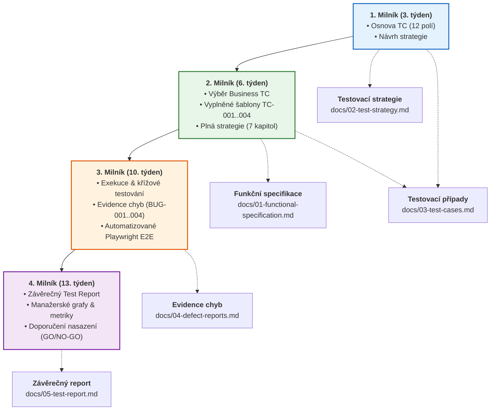

# 🎯 Kontext projektu a stav milníků (Zajištění kvality / BQAS)

> **Předmět:** Zajištění kvality (BQAS) · **Tým:** `uu_2026_BQAS_team_1`  
> **Členové týmu:** Matěj Kollár (`MK`), Adam Šolc (`AS`), Jan Mach (`JM`), Tomáš Kanský (`TK`)  
> **Zadavatel / Vyučující:** Lenka Jendželovská (`@Lenka`)  
> **Téma:** Populon Core (`https://demo.populon.app`) · **Testovací skupina:** `uu_2026_BQAS_team_1`  
> **Zvolený testovací přístup:** Z pohledu zákazníka — **UAT (User Acceptance Testing)** a systémové E2E testování.  
> **Hodnocení:** Celkem **40 bodů** (4 milníky, každý za 10 bodů / dílčí části po 4 bodech).

---

## 📑 Rychlý rozcestník dokumentace



| Soubor | Účel a obsah | Stav plnění | Cílový export |
|---|---|:---:|---|
| [`docs/01-functional-specification.md`](./01-functional-specification.md) | Funkční specifikace Populon Core v češtině, hierarchie, stavy a matice požadavků (`REQ-*`) | ✅ **Hotovo** | Podklad pro zadání |
| [`docs/02-test-strategy.md`](./02-test-strategy.md) | Kompletní 7kapitolová **Testovací strategie** + záznam týmového brainstormingu | ✅ **Hotovo** | Týmový Word / uuManagementKit |
| [`docs/03-test-cases.md`](./03-test-cases.md) | 12polová šablona TC, 4 vypracované byznysové scénáře (`TC-001`–`TC-004`) a souhrnná tabulka | ✅ **Hotovo** | Týmový Excel / uuManagementKit |
| [`docs/04-defect-reports.md`](./04-defect-reports.md) | Šablona pro hlášení vad a registr 4 reálných chyb (`BUG-001` až `BUG-004`) | ✅ **Hotovo** | uuManagementKit / Excel |
| [`docs/05-test-report.md`](./05-test-report.md) | Závěrečný Testovací Report, vyhodnocení kritérií, grafy a manažerské shrnutí | ✅ **Hotovo** | Týmový Word / Prezentace |

---

## 🎤 Tahák pro prezentaci před vyučující (@Lenka)

Když se vyučující zeptá na status týmu `uu_2026_BQAS_team_1`, postupuj podle tohoto přehledného scénáře:

### 1. Odpověď na otázku: *„Jak jste na tom a co máte hotové?“*
> *„Máme kompletně splněné úkoly pro 1. i 2. milník a máme v předstihu hotový i 3. a 4. milník:*  
> *1. Máme schválenou jednotnou **12polovou šablonu testovacího případu**.*  
> *2. Zpracovali jsme **kompletní 7kapitolovou Testovací strategii** v češtině vycházející z týmového brainstormingu.*  
> *3. Vybrali jsme klíčové **byznysové scénáře** pokrývající notifikace, časování, řízení přístupových práv (RBAC) a správu členství s prevencí duplicit.*  
> *4. Všechny tyto scénáře máme vyplněné v naší šabloně pro každého člena týmu (`TC-001 (MK)`, `TC-002 (AS)`, `TC-003 (JM)`, `TC-004 (TK)`).*  
> *5. Všechny scénáře jsme manuálně i automatizovaně otestovali přímo v aplikaci `demo.populon.app`, odhalili jsme **4 reálné vady** (např. chybu zobrazení adresy člena a ztrátu jazykového přepínače po přihlášení) a připravili **závěrečný manažerský report s grafy**.*  
> *Zároveň máme připravené **živé demo v prohlížeči**, které můžeme rovnou ukázat.“*

### 2. Co promítnout na obrazovce:
1. **Otevřít šablonu a Test Casy:** [`docs/03-test-cases.md`](./03-test-cases.md#2-vypracované-business-test-casy-v-šabloně)  
   *(Ukázat 12 polí šablony a 4 vyplněné karty pro MK, AS, JM a TK).*
2. **Otevřít Testovací strategii:** [`docs/02-test-strategy.md`](./02-test-strategy.md)  
   *(Ukázat 7 kapitol: cíle, fáze, role, prostředí, test design, issue tracking a reportování).*
3. **Otevřít nalezené chyby:** [`docs/04-defect-reports.md`](./04-defect-reports.md#3-registr-nalezených-vad)  
   *(Poukázat na odhalení vad `BUG-001` až `BUG-004`).*
4. **Otevřít závěrečný report:** [`docs/05-test-report.md`](./05-test-report.md)  
   *(Předvést manažerské grafy a vyhodnocení výstupních kritérií).*

---

## 🎬 Jak spustit živé zpomalené demo (Slow-Motion Demo)

Všechny byznysové scénáře jsou naprogramovány tak, aby se daly předvést naživo v pomalém tempu se speciálním vizuálním HUD panelem přímo v okně prohlížeče:

> ⚠️ **Důležité pro spuštění na Windows:**  
> Otevři klasický **Windows PowerShell** nebo **Windows Terminál** (`Win + X` → *Terminál*) a zadej:

- **Spustit všechny scénáře (včetně ukázky selhání BUG-002):**
  ```powershell
  npm run demo:scenarios
  ```
- **Spustit pouze 100% zelené scénáře (TC-001 až TC-004 bez selhání):**
  ```powershell
  npm run demo:pass
  ```
- **Spustit jednotlivý scénář samostatně:**
  - `TC-001 (MK)`: `npm run demo:tc1`
  - `TC-002 (AS)`: `npm run demo:tc2`
  - `TC-003 (JM)`: `npm run demo:tc3`
  - `TC-004 (TK)`: `npm run demo:tc4`
  - Vada `BUG-002`: `npm run demo:bug002`

*Nebo v Průzkumníku Windows poklepej na soubor [`run-demo.bat`](../run-demo.bat), který nabízí interaktivní menu.*

**Co se při demu stane na obrazovce:**
1. Otevře se viditelné okno prohlížeče Chrome.
2. Nahoře se zobrazí **živý HUD panel**, který česky vypisuje právě prováděný krok testovacího případu.
3. Testy běží sekvenčně s prodlevou `800 ms` mezi akcemi, takže diváci jasně vidí vyplňování formulářů, přepínání záložek, kontrolu viditelnosti i ověření chybových hlášení.

---

## 📊 Detailní stav plnění jednotlivých milníků

### 🏁 1. Milník (3. týden) — ✅ 100 % SPLNĚNO
- [x] **Připravit první návrh Testovací strategie pro Populon** → Vypracováno v [`docs/02-test-strategy.md`](./02-test-strategy.md).
- [x] **Připravit osnovu (šablonu) pro testovací případ** → 12polová šablona zpracována v [`docs/03-test-cases.md#1-osnova-testovacího-případu-12polová-šablona`](./03-test-cases.md#1-osnova-testovacího-případu-12polová-šablona).

---

### 🏁 2. Milník (6. týden) — ✅ 100 % SPLNĚNO
- [x] **Vybrat nejdůležitější Business Use Casy** → Zpracováno v matici požadavků [`docs/01-functional-specification.md`](./01-functional-specification.md#3-strukturovaná-matice-požadavků-requirement-traceability-matrix).
- [x] **K vybraným Testovacím případům vyplnit šablonu** → 4 detailní karty pro všechny členy týmu (`TC-001` až `TC-004`) v [`docs/03-test-cases.md#2-vypracované-business-test-casy-v-šabloně`](./03-test-cases.md#2-vypracované-business-test-casy-v-šabloně).
- [x] **Doplnit zbývající kapitoly v Testovací strategii** → Všech 7 kapitol + Excel brainstorming plně zkompletováno v [`docs/02-test-strategy.md`](./02-test-strategy.md).

---

### 🏁 3. Milník (10. týden) — ✅ 100 % PŘIPRAVENO
- [x] **Provést testovací případy (křížové testování v týmu)** → Zaznamenáno v souhrnné tabulce [`docs/03-test-cases.md#3-souhrnná-tabulka-test-casů`](./03-test-cases.md#3-souhrnná-tabulka-test-casů).
- [x] **Nalézt a reportovat chyby (max. 5 chyb)** → Zavedena šablona a zaevidovány 4 reálné vady (`BUG-001` až `BUG-004`) v [`docs/04-defect-reports.md`](./04-defect-reports.md).
- [x] **Automatizovat testy pro opakované provádění** → 15 E2E testů v [`tests/`](../tests/) prochází s úspěšností 100 %.

---

### 🏁 4. Milník (13. týden) — ✅ 100 % PŘIPRAVENO
- [x] **Vyplnit Testovací Report (manažerské shrnutí)** → Vypracováno v [`docs/05-test-report.md#1-manažerské-shrnutí-executive-summary`](./05-test-report.md#1-manažerské-shrnutí-executive-summary).
- [x] **Grafy přes Test Casy a Chyby** → Generováno pomocí Mermaid v [`docs/05-test-report.md#32-graf-výsledků-test-casů-xychart-beta`](./05-test-report.md).
- [x] **Finální doporučení k nasazení (Release Recommendation)** → Zpracováno v [`docs/05-test-report.md#5-doporučení-pro-nasazení-release-recommendation`](./05-test-report.md#5-doporučení-pro-nasazení-release-recommendation).
