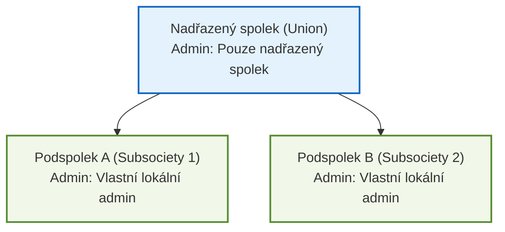
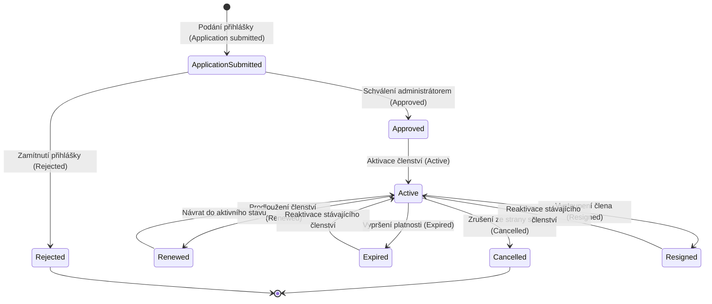

# 📄 Funkční specifikace — Populon Core

> **Zdrojový podklad:** `Populon Core — Functional Specification`  
> **Autor a zadavatel:** Lenka Jendželovská (`@Lenka`), 3. 10. 2026  
> **Předmět:** Zajištění kvality (BQAS) · Tým: `uu_2026_BQAS_team_1`  
> **Účel dokumentu:** Oficiální funkční specifikace systému Populon Core převedená do přehledné strukturované češtiny pro prezentaci, konzultace a návazné mapování na Testovací strategii (`docs/02-test-strategy.md`) a Test Casy (`docs/03-test-cases.md`).

---

## 1. Manažerský přehled systému (Overview)

**Populon** je moderní platforma pro správu spolků, klubů, asociací a zájmových organizací. Slouží k efektivnímu řízení členské základny, komunikaci se členy (notifikace) a organizaci společných událostí (aktivity).

Dokument popisuje zamýšlenou funkcionalitu na konceptuální úrovni jako základ pro akceptační a systémové testování.

### 🎯 Rozsah systému (In Scope vs. Out of Scope)

| Oblast | Zařazení | Klíčový obsah |
|---|---|---|
| **1. Spolky a členství (Societies & Membership)** | 🟢 **In Scope** | Hierarchie spolků, typy členství, životní cyklus přihlášky, izolace admin práv, prevence duplicit |
| **2. Vlastní členská pole (Custom Member Data Fields)** | 🟢 **In Scope** | Dynamická pole (`features`), datové typy, povolené hodnoty, 4 úrovně viditelnosti |
| **3. Aktivity a akce (Activities)** | 🟢 **In Scope** | Události, kapacita, poplatky, 5 úrovní viditelnosti, stavy účastníků, proces zrušení akce |
| **4. Oznámení a zprávy (Notifications)** | 🟢 **In Scope** | Publikace novinek, časování (`Release date` / `Ending date`), 5 úrovní viditelnosti, push/in-app |
| **Suomi.fi registrace a opatrovníci (Helsinky)** | ⚪ **Out of Scope** | Specifické napojení na finskou státní identitu a mládežnická centra |
| **Nativní mobilní aplikace (iOS/Android)** | ⚪ **Out of Scope** | Testuje se výhradně webová aplikace `demo.populon.app` |
| **Reportingová aplikace** | ⚪ **Out of Scope** | Samostatný externí analytický modul |
| **Platební brána a transakce** | ⚪ **Out of Scope** | Testuje se pouze evidence částky poplatku, nikoliv proces platby |

---

## 2. Detailní specifikace modulů

### 2.1 Spolky a členství (Societies & Membership)

Spolek (**Society**) představuje organizaci, do které mohou patřit fyzické i právnické osoby. Spolky lze organizovat do hierarchické struktury, kde nadřazený spolek (**Union**) zastřešuje jeden nebo více podspolků (**Subsocieties**).

#### Klíčová pravidla modulu:
1. **Typy členství:** Uživatel může mít členství typu **Member** (jednotlivec / fyzická osoba) nebo zastupovat členství typu **Company** (firemní členství, kde vystupuje jeden nebo více zástupců).
2. **Souběžná členství:** Jeden uživatel může mít neomezený počet souběžných členství v různých spolcích současně (včetně souběžného členství v nadřazeném spolku i v podspolku).
3. **Izolace administrátorských práv (Kritické bezpečnostní pravidlo):** Každý spolek má vlastní administrátory. Správce nadřazeného spolku (`Union`) se **nestává** automaticky správcem jeho podspolků (`Subsocieties`) — administrátorská práva musí být udělena pro každý spolek explicitně.
4. **Prevence duplicitních členství a reaktivace:** Pokud uživatel požádá o vstup do spolku, kde již záznam o členství má (v jakémkoliv stavu, např. propadlé nebo zrušené), systém nesmí vytvořit duplicitní záznam, ale nabídne obnovení (**reaktivaci**) existujícího členství.

#### Životní cyklus členství (Membership Lifecycle):

---

### 2.2 Vlastní datová pole členů (Custom Member Data Fields)

Administrátor spolku může bez zásahu vývojářů nebo úpravy kódu definovat **vlastní datová pole** (*features*), která umožňují shromažďovat doplňující informace o členech.

#### Vlastnosti pole:
- **Název** (*Name*) a volitelný **popis** (*Description*).
- **Datový typ:** `string` (text), `integer` (celé číslo), `decimal` (desetinné číslo), `date` (datum).
- **Seznam povolených hodnot:** Volitelné omezení výběru pro člena.
- **Příznak systémového pole:** Rozlišení mezi systémovým polem spravovaným platformou (nelze editovat adminem) a polem vytvořeným spolkem.
- **Ochrana dříve zadaných dat:** Změna nebo omezení povolených hodnot ovlivní pouze nově zadávané nebo upravované hodnoty — dříve uložená data členů **nesmí být nikdy retroaktivně zneplatněna**.
- **Zpětná dostupnost:** Nově vytvořené pole je okamžitě dostupné k vyplnění a zobrazení u všech členů daného spolku (včetně členství vzniklých před vytvořením pole).

#### Úrovně viditelnosti vlastních polí (4 úrovně):

| Úroveň viditelnosti | Kdo má přístup | Účel použití |
|---|---|---|
| 👁️ **Viditelné všem (Visible to everyone)** | Kdokoliv, kdo má oprávnění zobrazit profil daného člena | Veřejné zájmy, pozice v týmu |
| 👤 **Pouze danému členovi (Member only)** | Pouze konkrétní člen po přihlášení | Osobní preference, soukromé poznámky |
| 🛡️ **Pouze administrátorům (Admins only)** | Pouze správci daného spolku | Interní poznámky k platbám, interní hodnocení |
| 🔒 **Neviditelné (Invisible / Internal)** | Nikdo v UI (pouze interní systémové zpracování) | Technické identifikátory, metadata |

---

### 2.3 Aktivity a události (Activities)

Spolek může pořádat aktivity (akce, tréninky, schůze) pro své členy i veřejnost.

#### Parametry aktivity:
- Časové rozmezí (datum a čas od–do).
- Volitelný účastnický poplatek (*Participation fee*).
- Volitelná maximální kapacita účastníků (*Max capacity*).
- **Zrušení aktivity:** Při zrušení akce systém automaticky odešle notifikaci všem přihlášeným účastníkům a okamžitě zablokuje možnost nových registrací.

#### Úrovně viditelnosti aktivit (5 úrovní):

| Úroveň viditelnosti | Popis oprávnění |
|---|---|
| 🌐 **1. Všichni (Everyone)** | Viditelné pro kohokoliv, včetně anonymních návštěvníků webu |
| 👥 **2. Registrovaní uživatelé (Any logged-in user)** | Viditelné pro každého přihlášeného uživatele v celém Populonu |
| 🏛️ **3. Pouze členové spolku (Members of society only)** | Viditelné výhradně pro členy pořadatelského spolku |
| 🎯 **4. Vybraný seznam členů (Hand-picked members)** | Viditelné pouze pro ručně vybrané členy |
| 🛡️ **5. Pouze administrátoři (Admins only)** | Viditelné pouze pro vedení a správce spolku (např. koncept akce) |

#### Stavy účastníka na aktivitě:
Systém eviduje přesný stav každého uživatele:
`invited` (pozván) → `accepted` (přijal účast) / `declined` (odmítl účast) / `joined by themselves` (přihlásil se sám z veřejného přehledu).

---

### 2.4 Oznámení a zprávy (Notifications)

Administrátor spolku může publikovat zprávy, oznámení a připomínky určené členům nebo veřejnosti.

#### Parametry notifikace:
- **Základní údaje:** Název (*Title*), Krátký popis (*Description*), Plný text zprávy (*Text*).
- **Časování zveřejnění:** Povinné datum vydání (*Release date*) a volitelné datum ukončení platnosti (*Ending date*). Před datem `Release date` nesmí být notifikace pro běžné členy ani veřejnost dostupná.
- **Kanály doručení:** Zobrazení uvnitř aplikace (*In-app*) a volitelně jako *Push zpráva*.

#### Úrovně viditelnosti notifikací (5 úrovní):

| Úroveň viditelnosti | Kdo notifikaci vidí |
|---|---|
| 🌐 **1. Všichni (Visible to everyone)** | Zobrazuje se veřejně na profilu spolku i anonymním návštěvníkům |
| 👥 **2. Registrovaní uživatelé (Registered users)** | Jakýkoliv přihlášený uživatel v systému |
| 🏛️ **3. Všichni členové spolku (Members only)** | Pouze aktivní členové dané skupiny |
| 🎯 **4. Vybraný seznam členů (Hand-picked members)** | Pouze konkrétně adresovaní členové |
| 🛡️ **5. Pouze administrátoři (Admins only)** | Pouze správci daného spolku |

---

## 3. Strukturovaná matice požadavků (Requirement Traceability Matrix)

Každý požadavek má přiděleno jednoznačné ID pro přímé odkazování v [Testovací strategii](./02-test-strategy.md), v [Testovacích případech](./03-test-cases.md) i v [Reportech vad](./04-defect-reports.md):

| ID požadavku | Modul | Přesná specifikace požadavku (CZ) | Riziko / Priorita | Pokrytí Test Casem |
|---|---|---|---|---|
| **REQ-SOC-01** | Spolky & Členství | Hierarchie spolků: nadřazený spolek (`union`) může mít jeden či více podspolků (`subsocieties`). | 🟠 Vysoká | TC Backlog |
| **REQ-SOC-02** | Spolky & Členství | Typy členství: individuální člen (`Member`) nebo firemní zástupce (`Company`). | 🟡 Střední | TC Backlog |
| **REQ-SOC-03** | Spolky & Členství | Životní cyklus členství: `submitted` → `approved`/`rejected` → `active` → `renewed`/`expired`/`cancelled`/`resigned`. | 🟠 Vysoká | TC Backlog |
| **REQ-SOC-04** | Spolky & Členství | Souběžná členství: jeden uživatel může být nezávislým členem více spolků i svazu a podspolku naráz. | 🟠 Vysoká | TC Backlog |
| **REQ-SOC-05** | Spolky & Členství | **Izolace admin práv:** admin nadřazeného spolku (`union`) se **nestává** adminem podspolků (`subsocieties`). | 🔴 **Kritická** | TC Backlog |
| **REQ-SOC-06** | Spolky & Členství | **Prevence duplicit a reaktivace:** při žádosti o vstup bývalého člena systém nabídne reaktivaci místo vytvoření duplicity. | 🟠 Vysoká | **TC-004 (TK)** |
| **REQ-FLD-01** | Vlastní pole | Tvorba vlastních polí adminem bez kódu: název, popis, datový typ (`string`, `integer`, `decimal`, `date`), povolené hodnoty, příznak systémového pole. | 🟠 Vysoká | TC Backlog |
| **REQ-FLD-02** | Vlastní pole | **4 úrovně viditelnosti polí:** viditelné všem, pouze členovi, pouze adminům spolku, neviditelné (interní). | 🔴 **Kritická** | **TC-004 (TK)** |
| **REQ-FLD-03** | Vlastní pole | **Ochrana historických dat:** změna povolených hodnot pole nesmí retroaktivně zneplatnit již dříve uložená data. | 🟠 Vysoká | TC Backlog |
| **REQ-FLD-04** | Vlastní pole | **Zpětná dostupnost pole:** nové pole je dostupné a editovatelné i pro členství vzniklá před jeho vytvořením. | 🟠 Vysoká | **TC-004 (TK)** |
| **REQ-ACT-01** | Aktivity | Vytvoření akce: rozmezí datum/čas od–do, volitelný poplatek, volitelná maximální kapacita. | 🟡 Střední | TC Backlog |
| **REQ-ACT-02** | Aktivity | **5 úrovní viditelnosti akce:** všichni, přihlášení, členové spolku, vybraný seznam, pouze admini. | 🔴 **Kritická** | TC Backlog |
| **REQ-ACT-03** | Aktivity | Účast a stavy: člen se může přihlásit/odmítnout; stavy `invited`, `accepted`, `declined`, `joined by themselves`. | 🟡 Střední | TC Backlog |
| **REQ-ACT-04** | Aktivity | Zrušení akce: zrušení odešle notifikaci přihlášeným a zablokuje další přihlašování. | 🟠 Vysoká | TC Backlog |
| **REQ-NOT-01** | Notifikace | Publikace oznámení: název, popis, text, povinný `Release date` a volitelný `Ending date`. | 🟡 Střední | **TC-001 (MK)**, **TC-003 (JM)** |
| **REQ-NOT-02** | Notifikace | **5 úrovní viditelnosti notifikací:** všichni, registrovaní, členové spolku, vybraný seznam, pouze admini. | 🔴 **Kritická** | **TC-001 (MK)**, **TC-002 (AS)**, **TC-003 (JM)** |
| **REQ-NOT-03** | Notifikace | Kanály doručení: in-app notifikace na webu a volitelné push zprávy. | 🟢 Nízká | TC Backlog |

---

## 4. Příloha: Původní znění specifikace v angličtině (Verbatim Reference)

<b>Klikněte pro zobrazení původního znění v angličtině (Oct 3, 2026 · @Lenka)</b>

### Overview
Populon is a membership-management platform for societies — clubs, associations and similar member organisations — to manage memberships, communicate with members, and run activities. This document describes its intended functionality at a conceptual level, as the basis for a detailed implementation discussion with the development team.

**Scope:** Societies & Membership, Custom Member Data Fields, Activities, and Notifications. Items not covered here are listed under Out of Scope at the end.

### Societies & Membership
A Society is a group that people and companies can belong to; societies can be organized into a hierarchy, where a parent society (a "union") has one or more subsocieties.
- A user may hold a Member membership (an individual) or represent a Company membership (one or more people act as its representatives).
- A membership shall move through a lifecycle: application submitted → approved or rejected → active → renewed, expired, cancelled, or resigned.
- A single user may hold multiple memberships at once across different societies, including being a member of both a parent union and one of its subsocieties simultaneously.
- Each society shall have its own admins. An admin of a union shall not automatically become an admin of its subsocieties — admin rights must be granted per society.
- When a user requests to join a society they already have a membership record for (in any status, including expired or resigned), the system shall find and offer to reactivate that existing membership rather than create a duplicate.

### Custom Member Data Fields
A society admin shall be able to define custom data fields ("features") to collect additional information from members, without any code change.
- Each feature has: a name, an optional description, a data type (string / integer / decimal / date), an optional list of allowed values restricting what a member may enter, a flag marking it as a system feature (managed by the platform, not editable by the society admin) versus a society-defined feature, and a visibility level.
- Visibility levels shall include at least: visible to everyone who can view the member, visible to the member only, visible to society admins only, and invisible (used internally, never shown to anyone).
- Restricting or changing a feature's allowed values shall affect only new or changed answers — values already stored shall never be invalidated retroactively.
- A feature's value shall be visible and editable (where the visibility level allows) on every membership it applies to, including memberships that existed in the society before the feature itself was created.

### Activities
A society shall be able to create Activities (events) for its members, each with a scheduled date range, an optional participation fee, and an optional maximum number of participants.
- Each activity has a visibility level, at minimum: visible to everyone (including users with no society membership at all), visible to any registered/logged-in user, visible to members of the organizing society only, visible only to a hand-picked list of members, and visible to admins only.
- A member shall be able to join or decline an activity they can see. The system shall track each participant's state (e.g. invited, accepted, declined, joined by themselves).
- Cancelling an activity shall notify its existing participants and block any new registrations.

### Notifications
A society admin shall be able to publish Notifications to communicate with members — news, announcements, reminders.
- Each notification has a visibility level controlling its audience, at minimum: visible to everyone (including anonymous site visitors), visible to any registered user, visible to all members of the organizing society, visible only to a hand-picked list of members, and visible to admins of the organizing society only.
- Members shall optionally receive eligible notifications as push messages, in addition to seeing them in-app.

### Out of Scope
- The Suomi.fi self-registration and guardian/renewal flow for Helsinki city youth centres.
- The native mobile app.
- The reporting application.
- Payment processing details beyond what is needed to understand an Activity's participation fee.

