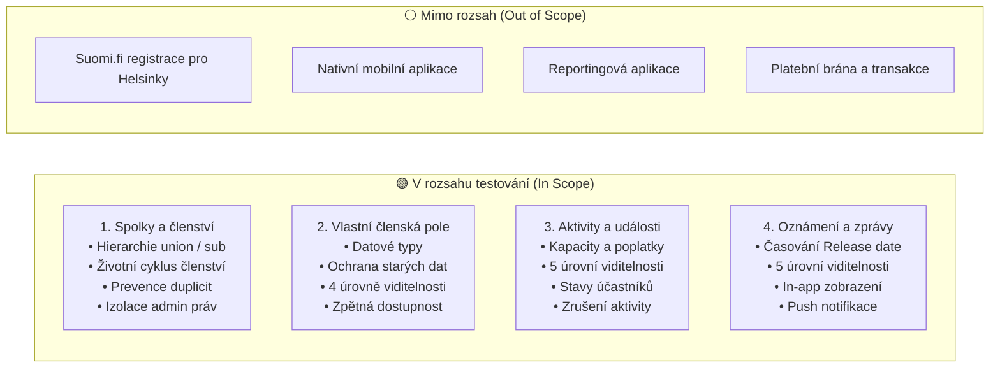
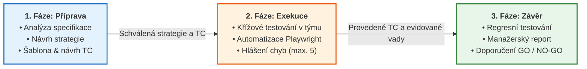
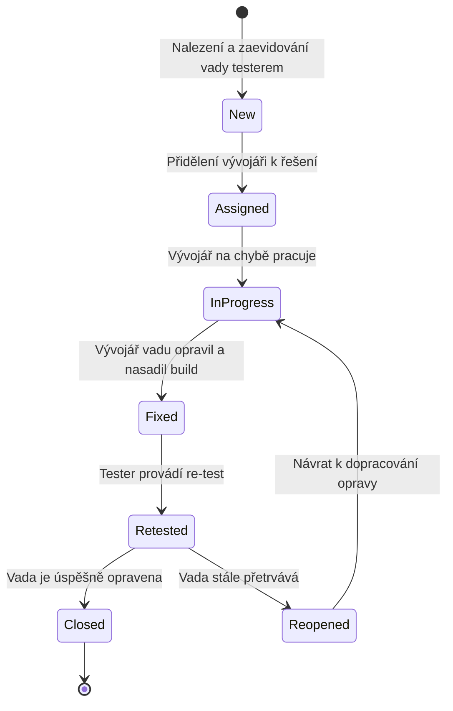

# 🧭 Testovací strategie — Populon Core

> **Předmět:** Zajištění kvality (BQAS) · Tým: `uu_2026_BQAS_team_1`  
> **Cílové výstupy pro odevzdání:** Týmový Word, Týmový Excel (list `BQAS | Brainstorming testovací strategie`) a `uuManagementKit`.  
> **Zvolený testovací přístup:** Z pohledu zákazníka — **UAT (User Acceptance Testing)** a nezávislé systémové E2E testování.  
> **Testovaná aplikace:** Populon Core (`https://demo.populon.app`)

---

## 📑 Osnova testovací strategie

1. [Cíl testování a rozsah (Testing Goals & Scope)](#1-cíl-testování-a-rozsah)
2. [Fáze testování, vstupní a výstupní kritéria](#2-fáze-testování-vstupní-a-výstupní-kritéria)
3. [Role a odpovědnosti v týmu](#3-role-a-odpovědnosti-v-týmu)
4. [Testovací prostředí a testovací data](#4-testovací-prostředí-a-testovací-data)
5. [Návrh testů a testovací techniky (Test Design)](#5-návrh-testů-a-testovací-techniky)
6. [Správa a řízení defektů (Issue Tracking)](#6-správa-a-řízení-defektů-issue-tracking)
7. [Reportování a metriky kvality](#7-reportování-a-metriky-kvality)
8. [Příloha: Týmový brainstorming z 1. milníku](#8-příloha-týmový-brainstorming-z-1-milníku-excel)

---

## 1. Cíl testování a rozsah

### 1.1 Hlavní cíl testování
Hlavním cílem testování je nezávisle ověřit, že klíčové funkcionality platformy **Populon Core** fungují v naprostém souladu s [funkční specifikací](./01-functional-specification.md).

Zvláštní důraz je kladen na:
- **Přístupová práva a bezpečnost (RBAC / GDPR):** Kdo má právo vidět a upravovat jaká data napříč spolky a úrovněmi viditelnosti.
- **Životní cyklus členství a prevenci duplicit:** Správné přechody stavů a reaktivace bývalých členství.
- **Integritu členských dat:** Zachování platnosti starších záznamů při změnách definic vlastních polí.
- **Časování a viditelnost:** Zpřístupnění notifikací a aktivit přesně v okamžik určený pořadatelem.

### 1.2 Rozsah testování (Scope)

### 1.3 Prioritizace podle rizik (Risk-based Testing)

| Úroveň rizika | Oblasti systému | Zdůvodnění rizika |
|---|---|---|
| 🔴 **Kritická (Critical)** | **Viditelnost dat a izolace admin práv** (`REQ-SOC-05`, `REQ-FLD-02`, `REQ-ACT-02`, `REQ-NOT-02`) | Únik neveřejných údajů členů nebo neoprávněný zásah admina svazu do autonomního podspolku představuje hrubé porušení GDPR a ztrátu důvěry zákazníků. |
| 🟠 **Vysoká (High)** | **Životní cyklus členství a integrita dat** (`REQ-SOC-03`, `REQ-SOC-06`, `REQ-FLD-03`, `REQ-FLD-04`, `REQ-ACT-04`) | Vznik duplicitních členství znehodnocuje databázi; retroaktivní smazání dat při změně povolených hodnot vlastního pole může způsobit ztrátu klientských dat. |
| 🟡 **Střední (Medium)** | **Standardní tvorba a správa entit** (`REQ-ACT-01`, `REQ-NOT-01`, `REQ-SOC-02`) | Běžné uživatelské scénáře (vytvoření notifikace, nastavení termínu aktivity) při dodržení Happy Path. |
| 🟢 **Nízká (Low)** | **Doplňkové kanály a vizuální prezentace** (`REQ-NOT-03`) | Push notifikace, drobné layoutové nuance rozhraní. |

---

## 2. Fáze testování, vstupní a výstupní kritéria

Testování je organizováno do 3 navazujících fází z pohledu zákaznického UAT a systémového testovacího týmu:

### Přehled vstupních a výstupních kritérií:

| Fáze testování | Vstupní kritéria (Entry Criteria) | Výstupní kritéria (Exit Criteria) |
|---|---|---|
| **1. Analýza specifikace a příprava testů** | • Schválená funkční specifikace `Populon Core — Functional Specification` • Stanovené týmové role v `uu_2026_BQAS_team_1` • Přístup do `uuManagementKit` | • Zodpovězené nejasnosti se stakeholderem (`@Lenka`) • Schválená 12polová šablona Test Casu • Zpracovaná Testovací strategie (Milník 1) |
| **2. Systémové, E2E a UAT testování** | • Dostupná instance `https://demo.populon.app` • Připravená skupina `uu_2026_BQAS_team_1` a testovací účty • Vyplněné Test Casy pro všechny členy týmu (Milník 2) | • 100 % provedených kritických a vysokých Test Casů • Křížové otestování scénářů mezi členy týmu (Milník 3) • Řádně zaevidované odhalené vady (max. 5 vad) |
| **3. Regresní a akceptační testování** | • Dodané opravy nahlášených vad od vývojářů • Funkční automatizovaná Playwright sada | • 0 otevřených kritických (Critical) vad • Úspěšný 100% průchod automatizovaných regresních testů • Vypracovaný a schválený závěrečný Test Report (Milník 4) |

---

## 3. Role a odpovědnosti v týmu

| Role | Zodpovědná osoba / Tým | Hlavní odpovědnosti |
|---|---|---|
| **QA Engineer / Tester (UAT tým)** | Členové týmu `uu_2026_BQAS_team_1`: • **MK** — Matěj Kollár • **AS** — Adam Šolc • **JM** — Jan Mach • **TK** — Tomáš Kanský | • Návrh a aktualizace Testovací strategie a šablony TC • Výběr prioritních Business Test Casů a jejich vyplnění v šabloně • Vzájemné křížové manuální provádění testů • Implementace automatizovaných Playwright E2E testů s live demem • Vyhledání, analýza a hlášení vad (max. 5 chyb pro 3. milník) • Sestavení závěrečného Test Reportu a prezentace výsledků |
| **Stakeholder / Zadavatel (3. strana)** | Lenka Jendželovská (`@Lenka`) | • Dodání funkční specifikace Populon Core • Zodpovídání dotazů a vyjasňování požadavků na konzultacích • Posouzení závažnosti nahlášených vad • Formální akceptace výstupů milníků |
| **Vývojový tým (Developers — 3. strana)** | Externí vývojáři aplikace Populon | • Provoz a údržba testovacího prostředí `demo.populon.app` • Interní unit a integrační testy • Oprava nahlášených chyb (Bug Fixing) a nasazování buildů |

---

## 4. Testovací prostředí a testovací data

### 4.1 Technické parametry prostředí
- **URL testovací instance:** `https://demo.populon.app`
- **Povaha prostředí:** Neveřejná demo instance bez produkčních dat. Veškeré záznamy jsou syntetické (ochrana osobních údajů v souladu s GDPR).
- **Prohlížeče:** Google Chrome / Chromium (desktop).
- **Automatizační framework:** **Playwright v1.50+** s **TypeScriptem** v architektuře Page Object Model (POM) s podporou vizuálního zpomaleného režimu (**Slow-Motion Demo**, `slowMo: 800ms`).

### 4.2 Testovací data a role
- **Hlavní testovací skupina:** `uu_2026_BQAS_team_1` (`societyId=4516`).
- **Testované uživatelské role:**
  1. 🌐 **Anonymní uživatel (Public):** Nepřihlášený návštěvník (testování veřejné dostupnosti a blokace neveřejných dat).
  2. 👤 **Registrovaný nečlen (Non-member):** Uživatel přihlášený v Populonu, který není členem testované skupiny.
  3. 🏛️ **Člen spolku (Member):** Aktivní člen skupiny `uu_2026_BQAS_team_1` (`memberId=24096`).
  4. 🛡️ **Správce spolku (Society Admin):** Administrátor skupiny s právy zakládat notifikace, aktivity a upravovat členská pole.

---

## 5. Návrh testů a testovací techniky

Při návrhu testovacích případů uplatňujeme standardní techniky softwarového testování:

1. **Analýza stavových přechodů (State Transition Testing):**
   - Využito pro ověření životního cyklu členství (`submitted` → `approved` → `active` → `expired` → reaktivace).
   - Využito pro sledování stavů účastníka aktivity (`invited` → `accepted` / `declined`).
2. **Rozhodovací tabulky (Decision Tables / Visibility Matrix):**
   - Kombinatorické matice ověřující přístup všech 4 uživatelských rolí ke všem 4 úrovním viditelnosti vlastních polí a 5 úrovním viditelnosti notifikací/aktivit.
3. **Analýza hraničních hodnot a ekvivalenční třídy (BVA & EP):**
   - Časování publikace notifikace: pokus o zobrazení v čase `Release date - 1 min` (nesmí být vidět) vs. v čase `Release date` (musí být vidět).
   - Kapacita aktivity: registrace při volné kapacitě vs. pokus o přihlášení při naplněné kapacitě.
4. **Negativní a exploratorní testování:**
   - Pokus o neoprávněné otevření detailu notifikace či členské karty zkopírováním přímé URL adresy nepřihlášeným uživatelem.
   - Odesílání prázdných povinných polí ve formulářích.

---

## 6. Správa a řízení defektů (Issue Tracking)

> [!NOTE]
> V kontextu projektu Populon pojmy **Vada**, **Chyba**, **Defekt** a **Bug** označují stejnou skutečnost: odchylku chování systému od funkční specifikace.

### 6.1 Životní cyklus vady (Defect Lifecycle)

### 6.2 Klasifikace závažnosti (Severity):
- 🔴 **Kritická (Critical / Blocker):** Pád systému, prolomení přístupových práv nebo únik osobních údajů mezi spolky (porušení GDPR/RBAC), nemožnost dokončit klíčový proces bez náhradního řešení.
- 🟠 **Vysoká (High / Major):** Závažná odchylka klíčové byznys funkce od specifikace (např. vznik duplicity místo reaktivace, smazání historických dat při změně pole, notifikace viditelná před časem zveřejnění).
- 🟡 **Střední (Medium / Moderate):** Funkční vada s existujícím náhradním řešením (workaroundem) nebo neintuitivní chování UI.
- 🟢 **Nízká (Low / Cosmetic):** Drobné grafické nedostatky, překlepy v lokalizaci, chybějící zobrazení nepovinného údaje.

### 6.3 Povinná pole hlášení vady:
Každé hlášení v [Registru vad](./04-defect-reports.md) i v `uuManagementKitu` musí obsahovat:
1. **ID vady** (`BUG-001` až `BUG-005`)
2. **Název chyby** (stručný, jednoznačný)
3. **Vazba na TC a požadavek specifikace** (např. `TC-004 (TK)` / `REQ-FLD-04`)
4. **Kroky k reprodukci** (číslovaný postup)
5. **Očekávaný vs. Skutečný výsledek**
6. **Závažnost a Priorita**
7. **Příloha / Důkaz** (screenshot, video, Playwright trace)

---

## 7. Reportování a metriky kvality

1. **Průběžný status (Milníky 1–3):**
   - Prezentace stavu na cvičeních a konzultacích.
   - Sledování počtu připravených, provedených a automatizovaných Test Casů.
   - Evidence nově odhalených vad a jejich projednání se stakeholderem.
2. **Závěrečný Testovací Report (Milník 4):**
   - Vyhodnocení výstupních kritérií (Exit Criteria).
   - Metriky a grafy úspěšnosti Test Casů (`PASS`, `FAIL`, `BLOCKED`, `NOT RUN`).
   - Metriky a grafy rozdělení vad podle závažnosti a modulů.
   - Finální doporučení pro nasazení do produkce (**GO / NO-GO**).
   - Podrobný vzor je vypracován v [Závěrečném Test Reportu](./05-test-report.md).

---

## 8. Příloha: Týmový brainstorming z 1. milníku (Excel)

Tato kapitola zachycuje autentický záznam diskuse týmu `uu_2026_BQAS_team_1` z týmového Excelu z úvodní fáze projektu:

| č. | Kapitola strategie | Otázka pro tým | Původní námět / obsah | Stav řešení | Výsledné rozhodnutí týmu |
|---|---|---|---|---|---|
| **1** | Cíl testování | Co má testování potvrdit? | Ověřit, zda klíčové funkce Populonu odpovídají specifikaci. | ✅ Vyřešeno | Schváleno v kap. 1 naší strategie |
| **2** | Kontext a přístup | Kdo testuje? Agilně, nebo vodopádem? | Zvažujeme nezávislý FAT/SIT tým; přístup ještě není vybrán. | ✅ Vyřešeno | Zvolen přístup **z pohledu zákazníka — UAT** |
| **3** | Rozsah testování | Které části systému zahrnout? | Členství, vlastní pole, aktivity a oznámení. | ✅ Vyřešeno | Přesně odpovídá 4 in-scope modulům specifikace |
| **4** | Mimo rozsah | Co podle specifikace neřešíme? | Suomi.fi procesy, mobilní aplikace, reporting a platby. | ✅ Vyřešeno | Vyčleněno jako Out of Scope v kap. 1.2 |
| **5** | Typy testů | Jaké způsoby ověřování dávají smysl? | Funkční, integrační, oprávnění a regresní testy. | ✅ Vyřešeno | Kombinace UAT + automatizované E2E a smoke testy |
| **6** | Testovací prostředí | Jaké role, organizace a data potřebujeme? | Uživatel, člen, správce; nadřazený spolek a podspolky. | ✅ Vyřešeno | Založena skupina `uu_2026_BQAS_team_1` na `demo.populon.app` |
| **7** | Priority a rizika | Kde může mít chyba největší dopad? | Přístupová práva, kapacita akcí, časování publikace. | ✅ Vyřešeno | Zpracována riziková analýza v kap. 1.3 |
| **8** | Role v týmu | Kdo připravuje, provádí a vyhodnocuje testy? | Rozdělit v týmu; uvést i roli zadavatele. | ✅ Vyřešeno | Matěj Kollár, Adam Šolc, Jan Mach, Tomáš Kanský, `@Lenka` |
| **9** | Vstupní a výstupní kritéria | Kdy lze testování zahájit a ukončit? | Navrhnout kritéria dostupnosti funkcí a závažnosti vad. | ✅ Vyřešeno | Definována v tabulce v kap. 2 |
| **10** | Evidence vad | Jak zaznamenáme nalezené problémy? | ID vady, kroky reprodukce, očekávaný/skutečný stav. | ✅ Vyřešeno | Zavedena šablona a registr v `docs/04-defect-reports.md` |
| **11** | Rizika projektu | Co nám zatím chybí k rozhodnutí? | Výběr tématu Populon Core. | ✅ Vyřešeno | Potvrzeno a realizováno |
