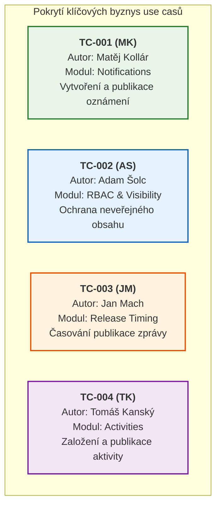

# 🧪 Testovací případy (Test Cases) a Šablona TC

> **Předmět:** Zajištění kvality (BQAS) · Tým: `uu_2026_BQAS_team_1`  
> **Cílové výstupy pro odevzdání:** Týmový Excel (listy `BQAS | Osnova testovacího případu`, `BQAS | Otevřené otázky a nápady`, list `Test Cases`) a `uuManagementKit`.  
> **Testovací skupina v Populonu:** `uu_2026_BQAS_team_1` (`https://demo.populon.app/societycard?societyId=4516`)

---

## 📑 Obsah dokumentu

1. [Osnova testovacího případu (12polová šablona z 1. milníku)](#1-osnova-testovacího-případu-12polová-šablona)
2. [Detailně vypracované Business Test Casy v šabloně (2. milník)](#2-vypracované-business-test-casy-v-šabloně)
   - [TC-001 (MK): Vytvoření a zobrazení notifikace ve skupině](#-šablona-pro-tc-001-mk-vytvoření-a-zobrazení-notifikace-ve-skupině)
   - [TC-002 (AS): Viditelnost notifikace pouze pro členy skupiny](#-šablona-pro-tc-002-as-viditelnost-notifikace-pouze-pro-členy-skupiny)
   - [TC-003 (JM): Časování zveřejnění notifikace (Release date)](#-šablona-pro-tc-003-jm-časování-zveřejnění-notifikace-release-date)
   - [TC-004 (TK): Založení a publikování nové aktivity ve skupině a kontrola jejího zobrazení na stránce Home](#-šablona-pro-tc-004-tk-založení-a-publikování-nové-aktivity-ve-skupině-a-kontrola-jejího-zobrazení-na-stránce-home)
3. [Souhrnná tabulka pro export do Excelu a uuManagementKitu](#3-souhrnná-tabulka-test-casů)
4. [Záznam diskusního listu z Excelu (Otevřené otázky a nápady)](#4-záznam-diskusního-listu-z-excelu-nápady-a-otázky)
5. [Přehled automatizace v Playwrightu (100% pokrytí scénářů)](#5-přehled-automatizace-v-playwrightu)

---

## 1. Osnova testovacího případu (12polová šablona)

Tato šablona byla schválena v rámci **1. milníku** a slouží jako závazný standard pro zápis všech testovacích scénářů našeho týmu:

| # | Pole šablony | Význam a účel pole | Instrukce pro vyplnění |
|:---:|---|---|---|
| **1** | **TC-ID** | Jedinečný kód testovacího případu | Např. `TC-001` doplněný o iniciály autora, např. `TC-001 (MK)` |
| **2** | **Název** | Výstižný název testovaného scénáře | Stručný popis v češtině vystihující podstatu testu |
| **3** | **Požadavek / reference** | Přímá vazba na funkční specifikaci | Kód požadavku z matice ([`REQ-*`](./01-functional-specification.md#3-strukturovaná-matice-požadavků-requirement-traceability-matrix)) a cesta v UI |
| **4** | **Cíl testu** | Co přesně má test prokázat | Jednoznačná deklarace očekávaného chování systému |
| **5** | **Priorita** | Důležitost scénáře | `Vysoká` / `Střední` / `Nízká` |
| **6** | **Předpoklady** | Výchozí stav aplikace a uživatele | Efektivní popis výchozího stavu bez nutnosti opakovat triviální přihlášení |
| **7** | **Testovací data** | Konkrétní hodnoty a parametry | Přesné texty, časy, názvy entit, testovací účty |
| **8** | **Kroky** | Číslovaný postup testera | Jednoznačné kroky (`1.`, `2.`, `3.`, ...) |
| **9** | **Očekávaný výsledek** | Správné chování podle specifikace | Číslované body navázané na jednotlivé kroky |
| **10** | **Skutečný výsledek** | Pozorované chování při exekuci | Vyplňuje se při provádění testu (3. milník) |
| **11** | **Výsledek / stav** | Finální stav exekuce | `PASS` (prošlo) / `FAIL` (neprošlo) / `BLOCKED` / `NOT RUN` |
| **12** | **ID vady / poznámka** | Odkaz na hlášení zjištěného problému | Odkaz do [Registru vad](./04-defect-reports.md) (např. `BUG-001`) nebo poznámka k automatizaci |

---

## 2. Vypracované Business Test Casy v šabloně

V rámci **2. milníku** jsme vybrali 4 nejdůležitější byznysové scénáře pokrývající klíčové moduly Populonu. Každý člen týmu garantuje jeden scénář:

---

### 📋 Šablona pro TC-001 (MK): Vytvoření a zobrazení notifikace ve skupině

> **Autor scénáře:** 👤 Matěj Kollár (`MK`) · **Priorita:** 🟠 `Vysoká` · **Stav:** ✅ `PASS`

| Pole šablony | Hodnota a specifikace |
|---|---|
| **TC-ID** | `TC-001 (MK)` |
| **Název** | Vytvoření a zobrazení notifikace ve skupině |
| **Požadavek / reference** | `REQ-NOT-01`, `REQ-NOT-02` (`Populon → Administration → Notifications → Vytvoření notifikace`) |
| **Cíl testu** | Ověřit, že administrátor může úspěšně vytvořit notifikaci, nastavit její viditelnost pro členy skupiny, projít třístupňovým průvodcem, zkontrolovat souhrn a publikovat ji na profilu skupiny. |
| **Priorita** | `Vysoká` |
| **Předpoklady** | Administrátor je přihlášen do Populonu a spravuje testovací skupinu `uu_2026_BQAS_team_1`. Je otevřena sekce administrace `Notifications`. |
| **Testovací data** | • **Skupina:** `uu_2026_BQAS_team_1` • **Title:** `První testovací notifikace` • **Description:** `v rámci prvního use casu, vytvářím první notifikaci pro seznámení se systémem` • **Text:** `Notifikace mají v Basic info čtyři povinná pole, Title, Description, Text a Release date, jedno volitelné a to Ending date. Další záložky jsou Visibility and receivers a Summary.` • **Release date:** `11/10/2026 21:48` • **Ending date:** *(ponecháno prázdné)* • **Visibility:** `Only to members of group` • **Send to new members:** `No` |
| **Kroky** | 1. V administraci skupiny otevřít záložku `Notifications` a kliknout na vytvoření nové notifikace. 2. V kroku `Basic info` vyplnit pole `Title`, `Description`, `Text` a `Release date` dle testovacích dat; pole `Ending date` ponechat prázdné. 3. Přejít na krok `Visibility & receivers`, zvolit viditelnost `Only to members of group` a volbu `Send to new members` nechat vypnutou. 4. Přejít na krok `Summary` a prověřit souhrn zadaných hodnot. 5. Kliknout na tlačítko `Save`. 6. Přejít na veřejnou stránku skupiny `uu_2026_BQAS_team_1` a otevřít záložku `Notifications`. 7. Kliknout na nově vytvořenou notifikaci `První testovací notifikace` a prověřit její detail. |
| **Očekávaný výsledek** | 1. Systém otevře třístupňového průvodce pro vytvoření notifikace. 2. Všechna povinná pole přijmou zadané údaje; nepovinné pole `Ending date` lze vynechat. 3. Viditelnost je úspěšně nastavena na členy pořadatelského spolku. 4. Krok `Summary` přehledně a správně rekapituluje název, popis, text zprávy i datum zveřejnění. 5. Notifikace se úspěšně uloží bez chybových hlášení. 6. V přehledu notifikací skupiny se zobrazuje karta nové notifikace. 7. V detailu notifikace se správně zobrazují všechny zadané texty. |
| **Skutečný výsledek** | Skutečné chování plně odpovídá očekávanému. Notifikace se úspěšně uložila a zobrazuje se jak v časové ose skupiny, tak v plném detailu. |
| **Výsledek / stav** | **`PASS`** |
| **ID vady / poznámka** | Scénář je plně automatizován v testu `TC-001 (MK)` v souboru `tests/scenarios.spec.ts`. |

---

### 📋 Šablona pro TC-002 (AS): Viditelnost notifikace pouze pro členy skupiny

> **Autor scénáře:** 👤 Adam Šolc (`AS`) · **Priorita:** 🔴 `Kritická` · **Stav:** ✅ `PASS`

| Pole šablony | Hodnota a specifikace |
|---|---|
| **TC-ID** | `TC-002 (AS)` |
| **Název** | Viditelnost notifikace pouze pro členy skupiny (Ochrana neveřejného obsahu) |
| **Požadavek / reference** | `REQ-NOT-02` (`Populon → Administration → Notifications → Visibility: Only to members of group`) |
| **Cíl testu** | Ověřit bezpečnostní pravidlo viditelnosti: notifikace určená pouze členům spolku je viditelná pro aktivního člena, ale nepřihlášený (anonymní) návštěvník ji neuvidí v přehledu a při pokusu o přímé otevření přes URL je mu přístup odepřen. |
| **Priorita** | `Vysoká` (Kritický bezpečnostní aspekt RBAC) |
| **Předpoklady** | Ve skupině `uu_2026_BQAS_team_1` existuje publikovaná notifikace (`První testovací notifikace`) s viditelností `Only to members of group`. Tester má k dispozici účet člena i přímou URL detailu. |
| **Testovací data** | • **Skupina:** `uu_2026_BQAS_team_1` • **Notifikace:** `První testovací notifikace` • **Přímá URL detailu:** `https://demo.populon.app/notificationcard?notificationId=7447` • **Role 1:** Aktivní člen skupiny `uu_2026_BQAS_team_1` • **Role 2:** Anonymní (nepřihlášený) uživatel |
| **Kroky** | 1. Přihlásit se jako aktivní člen skupiny, otevřít stránku skupiny `uu_2026_BQAS_team_1` → záložku `Notifications` a zkopírovat přímou URL detailu notifikace. 2. Zkontrolovat, že člen vidí plný obsah notifikace. 3. Odhlásit se ze systému a jako nepřihlášený anonymní návštěvník otevřít veřejný profil skupiny `uu_2026_BQAS_team_1` → záložku `Notifications`. 4. Zadat zkopírovanou URL adresu detailu notifikace přímo do adresního řádku prohlížeče. |
| **Očekávaný výsledek** | 1. Člen skupiny má k notifikaci plný přístup. 2. V detailu se členovi zobrazuje název i tělo zprávy. 3. Anonymní návštěvník v přehledu skupiny notifikaci nevidí (zobrazuje se zpráva `No new notifications`). 4. Při přímém zadání URL systém zablokuje zobrazení obsahu a vypíše bezpečnostní upozornění: *„This page has restricted access and you don't have permission to see it at the moment. Please, log in.“* |
| **Skutečný výsledek** | Skutečný výsledek odpovídá očekávanému chování. Oprávněný člen obsah vidí; neoprávněnému návštěvníkovi systém data neukáže ani přes přímou URL. |
| **Výsledek / stav** | **`PASS`** |
| **ID vady / poznámka** | Scénář je plně automatizován v testu `TC-002 (AS)` v souboru `tests/scenarios.spec.ts`. |

---

### 📋 Šablona pro TC-003 (JM): Časování zveřejnění notifikace (Release date)

> **Autor scénáře:** 👤 Jan Mach (`JM`) · **Priorita:** 🟠 `Vysoká` · **Stav:** ✅ `PASS`

| Pole šablony | Hodnota a specifikace |
|---|---|
| **TC-ID** | `TC-003 (JM)` |
| **Název** | Časování zveřejnění notifikace (Nedostupnost před Release date a zobrazení po něm) |
| **Požadavek / reference** | `REQ-NOT-01`, `REQ-NOT-02` (`Populon → Notifications → Basic info → Release date timing`) |
| **Cíl testu** | Ověřit časovou podmínku publikace: notifikace s datem zveřejnění v budoucnosti nesmí být pro člena dostupná před časem zveřejnění (ani v přehledu, ani přes přímý URL odkaz). Po uplynutí stanoveného času se notifikace členovi automaticky zpřístupní. |
| **Priorita** | `Vysoká` |
| **Předpoklady** | Správce je přihlášen do skupiny `uu_2026_BQAS_team_1` a má právo zakládat notifikace. Tester má k dispozici účet člena téže skupiny. |
| **Testovací data** | • **Skupina:** `uu_2026_BQAS_team_1` • **Title:** `Druhá testovací notifikace - budoucí vydání` • **Release date:** `24/10/2026 10:00` (budoucí datum) • **Visibility:** `Only to members of group` • **Send to new members:** `No` |
| **Kroky** | 1. Jako administrátor založit novou notifikaci s budoucím časem `Release date`. 2. Nastavit viditelnost `Only to members of group`, zkontrolovat `Summary` a uložit. 3. Z administrace zkopírovat přímý odkaz na detail vytvořené notifikace. 4. Přihlásit se jako běžný člen spolku v čase před `Release date`, zkontrolovat záložku `Notifications` ve skupině a pokusit se otevřít zkopírovaný odkaz. 5. Po nastání data a času `Release date` stránku obnovit a zkontrolovat záložku `Notifications` a uživatelský Dashboard. 6. Otevřít detail notifikace po čase vydání. |
| **Očekávaný výsledek** | 1. Notifikace se uloží a správce ji v administračním přehledu vidí s označením budoucího vydání. 2. Běžný člen před nastáním `Release date` notifikaci nevidí v přehledu a přímý odkaz odmítne zobrazení zprávy. 3. Po uplynutí `Release date` se notifikace automaticky zobrazí v časové ose skupiny i na dashboardu přihlášeného člena. 4. Detail notifikace po vydání řádně zobrazuje kompletní zadaný text. |
| **Skutečný výsledek** | Skutečný výsledek odpovídá očekávanému. Notifikace s budoucím datem je před vypršením času pro členy zcela skrytá a po jeho uplynutí je plně dostupná. |
| **Výsledek / stav** | **`PASS`** |
| **ID vady / poznámka** | Scénář je plně automatizován v testu `TC-003 (JM)` v souboru `tests/scenarios.spec.ts`. |

---

### 📋 Šablona pro TC-004 (TK): Založení a publikování nové aktivity ve skupině a kontrola jejího zobrazení na stránce Home

> **Autor scénáře:** 👤 Tomáš Kanský (`TK`) · **Priorita:** 🟠 `Vysoká` · **Stav:** ✅ `PASS`

| Pole šablony | Hodnota a specifikace |
|---|---|
| **TC-ID** | `TC-004 (TK)` |
| **Název** | Založení a publikování nové aktivity ve skupině a kontrola jejího zobrazení na stránce Home |
| **Požadavek / reference** | `REQ-ACT-01`, `REQ-ACT-02` (`Populon → My groups → Administration → Activities → Add / Publish → Home`) |
| **Cíl testu** | Ověřit, že administrátor skupiny může přes průvodce v administraci (`Activities → Add`) založit novou aktivitu s inkrementálním názvem `Test (TK) [číslo]`, přiřadit jí pozvaného člena, aktivitu uložit (`Save`), publikovat přes nabídku `Menu → Publish` a následně na stránce `Home` ověřit, že se publikovaná aktivita pozvanému členovi zobrazila. |
| **Priorita** | `Vysoká` |
| **Předpoklady** | Uživatel (`Tomáš Kanský`) má aktivní členství a administrátorská práva ve skupině `uu_2026_BQAS_team_1`. |
| **Testovací data** | • **Skupina:** `uu_2026_BQAS_team_1` • **Name (Název aktivity):** `Test (TK) [inkrementální číslo]` (např. `Test (TK) 2`) • **Pozvaný člen (Receivers):** `Tomáš Kanský` |
| **Kroky** | 1. Přihlásit se do systému Populon. 2. V horní navigaci kliknout na `My groups` a vybrat skupinu `uu_2026_BQAS_team_1`. 3. Na stránce skupiny kliknout na tlačítko `Administration`. 4. V levém administračním menu otevřít sekci `Activities` a kliknout na tlačítko `Add`. 5. Na 1. stránce průvodce (`Basic info`) vyplnit pole `Name` hodnotou `Test (TK) [inkrementální číslo]`. 6. Přejít přes `Page 2` (`Contact info`) a `Page 3` (`Settings`) na `Page 4` (`Receivers`). 7. V seznamu členů zaškrtnout člena, za kterého probíhá testování (`Tomáš Kanský`), a přejít na závěrečnou stránku průvodce (`Summary`). 8. Kliknout na tlačítko `Save` pro uložení aktivity. 9. V přehledu aktivit u nově vytvořené položky rozbalit tlačítko `Menu` a zvolit `Publish`. 10. V horní navigaci přejít na stránku `Home` a zkontrolovat, zda se nově publikovaná aktivita zobrazila v přehledu. |
| **Očekávaný výsledek** | 1. Uživatel je úspěšně přihlášen. 2. Zobrazí se profil skupiny `uu_2026_BQAS_team_1`. 3. Otevře se administrační rozhraní skupiny (`/manage/dashboard`). 4. Otevře se průvodce vytvořením nové aktivity na kroku `1 Basic info`. 5. Pole `Name` přijme zadaný název `Test (TK) [inkrementální číslo]`. 6. Průvodce plynule přejde přes `Page 2` a `Page 3` na krok `4 Receivers`. 7. Člen `Tomáš Kanský` je zaškrtnut a na souhrnné stránce (`Summary`) je uveden počet pozvaných členů (`Invited members: 1`). 8. Aktivita se uloží do tabulky aktivit ve stavu `UNPUBLISHED`. 9. Po akci `Menu → Publish` se stav aktivity v tabulce změní na `PUBLISHED`. 10. Na stránce `Home` (`/usercard`) je nově publikovaná aktivita `Test (TK) [inkrementální číslo]` viditelně zobrazena v přehledu aktivit. |
| **Skutečný výsledek** | Skutečný výsledek plně odpovídá očekávanému. Aktivita byla přes průvodce úspěšně založena, uložena, publikována přes `Menu → Publish` a ihned se zobrazila na stránce `Home`. |
| **Výsledek / stav** | **`PASS`** |
| **ID vady / poznámka** | Scénář je plně automatizován v testu `TC-004 (TK)` v souboru `tests/scenarios.spec.ts` (automaticky inkrementuje číslo aktivity `Test (TK) N`). |

---

## 3. Souhrnná tabulka Test Casů

Následující tabulka slouží jako přímý podklad pro export do **týmového Excelu** (list `Test Cases`) a do **uuManagementKitu**:

| TC-ID | Název | Požadavek | Cíl testu | Priorita | Předpoklady | Testovací data | Kroky | Očekávaný výsledek | Skutečný výsledek | Stav | ID vady |
|:---:|---|---|---|:---:|---|---|---|---|---|:---:|:---:|
| **TC-001 (MK)** | Vytvoření a zobrazení notifikace ve skupině | `REQ-NOT-01` `REQ-NOT-02` | Ověřit tvorbu notifikace správcem, nastavení viditelnosti pro členy a její zobrazení ve skupině. | Vysoká | Správce přihlášen, spravuje `uu_2026_BQAS_team_1`, otevřeny `Notifications`. | Title: První testovací notifikace, Release date: 11/10/2026, Visibility: Members | 1. Otevřít Notifications. 2. Vyplnit Basic info. 3. Zvolit viditelnost. 4. Zkontrolovat Summary. 5. Save. 6. Otevřít skupinu. 7. Ověřit detail. | Notifikace se uloží přes 3krokového průvodce a zobrazí se v záložce skupiny i v detailu. | Notifikace je vytvořena a zobrazuje se členům skupiny. | **PASS** | — |
| **TC-002 (AS)** | Viditelnost notifikace pouze pro členy skupiny | `REQ-NOT-02` | Ověřit, že notifikaci pro členy vidí člen, ale nevidí ji anonym (ani přes přímou URL). | Vysoká | Ve skupině existuje notifikace z TC-001 s viditelností pro členy. | Účet člena, URL `/notificationcard?notificationId=7447` | 1. Ověřit jako člen a zkopírovat URL. 2. Odhlásit se a otevřít Notifications skupiny. 3. Zadat URL jako anonym. | Člen notifikaci vidí. Anonym ji v přehledu nevidí a přímá URL odepře přístup. | Člen obsah vidí, anonymovi je přístup v přehledu i přes přímou URL odepřen. | **PASS** | — |
| **TC-003 (JM)** | Časování: Notifikace se před Release date nezobrazí a po něm ano | `REQ-NOT-01` `REQ-NOT-02` | Ověřit, že zpráva s budoucím Release date není členovi dostupná před časem vydání a po něm ano. | Vysoká | Správce přihlášen do skupiny `uu_2026_BQAS_team_1`, účet člena k dispozici. | Title: Druhá notifikace, Release date: 24/10/2026 10:00 | 1. Založit s budoucím časem. 2. Uložit. 3. Zkopírovat URL. 4. Přihlásit se jako člen před časem vydání. 5. Obnovit po čase vydání. 6. Otevřít detail. | Před Release date člen zprávu nevidí v přehledu ani přes URL; po uplynutí času se automaticky zobrazí. | Notifikace je před Release date nepřístupná, po uplynutí termínu se zobrazí. | **PASS** | — |
| **TC-004 (TK)** | Založení a publikování nové aktivity ve skupině a kontrola jejího zobrazení na stránce Home | `REQ-ACT-01` `REQ-ACT-02` | Ověřit založení nové aktivity správcem přes průvodce v administraci, přiřazení člena, uložení, publikování přes Menu -> Publish a zobrazení na stránce Home. | Vysoká | Uživatel má aktivní členství a admin práva ve skupině `uu_2026_BQAS_team_1`. | Skupina: `uu_2026_BQAS_team_1`, Name: `Test (TK) [inkrementální číslo]`, Člen: `Tomáš Kanský` | 1. Přihlášení. 2. My groups -> uu_2026_BQAS_team_1 -> Administration. 3. Activities -> Add. 4. Name: Test (TK)[číslo] -> Page 2 -> Page 3 -> Page 4. 5. Zaškrtnout člena -> Summary -> Save. 6. Menu -> Publish. 7. Kontrola zobrazení na Home. | Aktivita se uloží jako UNPUBLISHED, po Menu -> Publish získá stav PUBLISHED a zobrazí se pozvanému členovi na stránce Home. | Aktivita byla úspěšně založena, publikována a zobrazila se na stránce Home. | **PASS** | — |

---

## 4. Záznam diskusního listu z Excelu (Nápady a otázky)

Tento přehled zrcadlí týmový pracovní list `BQAS | Otevřené otázky a nápady` z 1. milníku:

| Oblast systému | Původní námět z diskuse | Otázka / hypotéza k vyřešení | Stav v týmu | Výsledné promítnutí |
|---|---|---|:---:|---|
| **Výběr tématu** | FAT/SIT vs. UAT | Jaký přístup zvolit? Jsme nezávislý tým nezkušených testerů. | ✅ Schváleno | Zvolen zákaznický UAT přístup |
| **Identita aplikace** | Populon Core | Reálná webová aplikace `demo.populon.app` | ✅ Schváleno | Skupina `uu_2026_BQAS_team_1` |
| **Členství** | Opakovaná přihláška bývalého člena | Nesmí vzniknout duplicitní členství, nabídnout obnovu | 💡 Nápad pro M3 | Zařazeno do backlogu testů |
| **Členství** | Jedna osoba ve více spolcích | Členství musí být nezávislá v různých skupinách | 💡 Nápad pro M3 | Zařazeno do backlogu testů |
| **Oprávnění** | Správce nadřazené organizace | Nemá automaticky práva v podspolku (izolace) | 💡 Nápad pro M3 | Zařazeno do backlogu testů |
| **Vlastní pole** | Změna povolených hodnot | Staré uložené hodnoty zůstávají platné | 💡 Nápad pro M3 | Zařazeno do backlogu testů |
| **Vlastní pole** | Nové pole u existujícího člena | Pole se má projevit i u starších členství | 💡 Nápad pro M3 | Zařazeno do backlogu testů |
| **Aktivity** | Založení a publikace aktivity pro členy | Zobrazí se publikovaná aktivita pozvanému členovi na Home? | ✅ Vyřešeno | Pokryto v **`TC-004 (TK)`** (`REQ-ACT-01`, `REQ-ACT-02`) |
| **Aktivity** | Zrušená akce | Upozornění účastníků a blokace registrací | 💡 Nápad pro M3 | Zařazeno do backlogu testů |
| **Oznámení** | Různé úrovně viditelnosti | Neoprávněný uživatel nesmí obsah vidět | ✅ Vyřešeno | Pokryto v **`TC-001`**, **`TC-002`**, **`TC-003`** |
| **Organizace práce** | Rozdělení v týmu | Kdo připraví strategii a kdo šablonu? | ✅ Vyřešeno | Každý člen týmu garantuje 1 TC |

---

## 5. Přehled automatizace v Playwrightu a spouštěcí příkazy

Všechny byznysové scénáře jsou plně automatizovány a připraveny k živé prezentaci ve zpomaleném režimu (`slowMo: 800ms`) s vizuálním in-browser HUD panelem:

| Režim spuštění | Popis a pokryté scénáře | Příkaz do Windows PowerShellu |
|---|---|---|
| **Všechny scénáře + vada BUG-002** | Spustí sekvenčně `TC-001` až `TC-004` (vše PASS) a na závěr test vady `BUG-002` (záměrný FAIL) | `npm run demo:scenarios` |
| **Pouze 100% zelené scénáře (PASS)** | Spustí pouze `TC-001` až `TC-004` bez testu vady (100% úspěšnost pro prezentaci) | `npm run demo:pass` |
| **Pouze TC-001 (MK)** | Vytvoření a publikace notifikace ve skupině (Matěj Kollár) | `npm run demo:tc1` |
| **Pouze TC-002 (AS)** | Ochrana neveřejné notifikace před anonymem / RBAC (Adam Šolc) | `npm run demo:tc2` |
| **Pouze TC-003 (JM)** | Časování zveřejnění notifikace dle Release date (Jan Mach) | `npm run demo:tc3` |
| **Pouze TC-004 (TK)** | Založení a publikování nové aktivity ve skupině a kontrola na Home (Tomáš Kanský) | `npm run demo:tc4` |
| **Pouze vada BUG-002** | Živá ukázka selhání způsobeného zmizením jazykového přepínače | `npm run demo:bug002` |
| **Interaktivní výběr (UI)** | Otevře Playwright UI okno pro výběr a krokování testů | `npm run demo:ui` |
