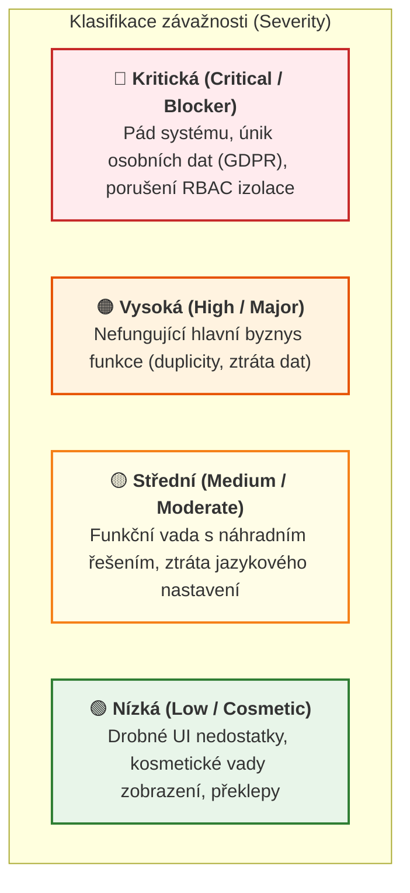

# 🐞 Evidence a šablona chyb (Defect Reports — 3. milník)

> **Předmět:** Zajištění kvality (BQAS) · Tým: `uu_2026_BQAS_team_1`  
> **Zadání 3. milníku (10. týden):**  
> *„Provést testovací případy, ideálně testovat jiný než svůj (prohodit si Test Casy). Zkusit nalézt a reportovat chyby (využít šablonu na report chyby) – **maximálně 5 chyb**.“*  
> **Cílové výstupy pro odevzdání:** `uuManagementKit` / Týmový Excel.

---

## 📑 Obsah dokumentu

1. [Šablona pro hlášení vady (Bug Report Template)](#1-šablona-pro-hlášení-vady-bug-report-template)
2. [Klasifikace závažnosti (Severity) a priority (Priority)](#2-klasifikace-závažnosti-a-priority)
3. [Registr nalezených vad v Populonu (Evidence pro 3. milník)](#3-registr-nalezených-vad)
4. [Detailní karty chyb pro přenos do uuManagementKitu a Excelu](#4-detailní-karty-chyb)
   - [BUG-001: Nevykreslení uložené adresy člena na přehledové kartě](#-bug-001-member-information-nevykreslení-uložené-adresy-člena)
   - [BUG-002: Zmizení jazykového přepínače a vynucení angličtiny po přihlášení](#-bug-002-localization-zmizení-jazykového-přepínače-po-přihlášení)
   - [BUG-003: Nepřeložené finské texty ve formuláři zpětné vazby v albánské mutaci](#-bug-003-localization-finský-formulář-v-albánské-mutaci-feedback)
   - [BUG-004: Duplicitní vykreslení chybové hlášky neúspěšného přihlášení](#-bug-004-authentication-duplicitní-vykreslení-chybového-alertu)
   - [BUG-005: Příprava pro další týmovou vadu z křížového testování](#-bug-005-volný-slot-pro-další-vadu-z-křížového-testování)

---

## 1. Šablona pro hlášení vady (Bug Report Template)

Tato šablona vychází ze schválené [Testovací strategie](./02-test-strategy.md#6-správa-a-řízení-defektů-issue-tracking):

| # | Pole šablony | Význam a účel | Příklad vyplnění |
|:---:|---|---|---|
| **1** | **ID vady** | Jednoznačný kód chyby | `BUG-001` až `BUG-005` |
| **2** | **Název chyby** | Výstižné shrnutí problému (*Kde + Co nefunguje*) | *Member information: Uložená adresa člena se nevykreslí na přehledové kartě* |
| **3** | **Vazba na TC / Požadavek** | Kód testu a funkčního požadavku | `TC-004 (TK)` / `REQ-FLD-04` |
| **4** | **Nahlásil (Tester)** | Jméno testera provádějícího test | `TK` (Tomáš Kanský) |
| **5** | **Datum nálezu** | Datum zjištění vady | `2026-10-23` |
| **6** | **Závažnost (Severity)** | Technický a byznysový dopad na systém | `Kritická` / `Vysoká` / `Střední` / `Nízká` |
| **7** | **Priorita (Priority)** | Naléhavost vyřešení vývojovým týmem | `P1` (okamžitě) až `P4` (nízká) |
| **8** | **Stav (Status)** | Fáze v životním cyklu vady | `Nová (New)` → `Přidělená` → `Opravená` → `Uzavřená` |
| **9** | **Prostředí** | URL, testovací skupina, prohlížeč | `https://demo.populon.app`, skupina `uu_2026_BQAS_team_1`, Chrome |
| **10** | **Předpoklady** | Výchozí stav nutný pro reprodukci | Uživatel je přihlášen jako aktivní člen |
| **11** | **Kroky k reprodukci** | Přesný číslovaný postup vedoucí k chybě | `1.`, `2.`, `3.`, ... |
| **12** | **Očekávaný výsledek** | Správné chování dle specifikace | Co systém má udělat |
| **13** | **Skutečný výsledek** | Pozorované chybné chování systému | Co systém reálně udělal (chybová hláška, UI vada) |
| **14** | **Důkaz / Příloha** | Screenshot, Playwright report nebo trace | Odkaz na report či automatizovaný test |

---

## 2. Klasifikace závažnosti a priority

---

## 3. Registr nalezených vad

Aktuální přehled reálných vad odhalených během testování Populon Core na instanci `demo.populon.app`:

| ID vady | Název chyby | Vazba na TC | Závažnost | Priorita | Stav | Nahlásil |
|:---:|---|---|:---:|:---:|:---:|:---:|
| **BUG-001** | Member information: Uložená adresa člena (`Street address`, `Zip code`, `City`) se nevykreslí na přehledové kartě | `TC-004 (TK)` | 🟢 Nízká | `P3` | `Nová (New)` | `TK` |
| **BUG-002** | Localization: Jazykový přepínač po přihlášení zcela zmizí z navigace a systém vynutí angličtinu | `TC-001` / UI | 🟡 Střední | `P3` | `Nová (New)` | `TK` |
| **BUG-003** | Localization: Formulář zpětné vazby (`/feedback`) v albánské mutaci (`SQ`) obsahuje nepřeložené finské texty | Lokalizace | 🟢 Nízká | `P4` | `Nová (New)` | `TK` |
| **BUG-004** | Authentication: Duplicitní vykreslení chybové hlášky neúspěšného přihlášení v panelu `#globalFeedback` | Autentizace | 🟢 Nízká | `P4` | `Nová (New)` | `TK` |
| **BUG-005** | *(Volný slot pro zaevidování 5. vady při křížovém testování ve 3. milníku)* | `TC-...` | — | — | `Připraveno` | — |

---

## 4. Detailní karty chyb

### 🐞 BUG-001: Member information: Uložená adresa člena se nevykreslí na přehledové kartě

| Parametr | Specifikace vady |
|---|---|
| **ID vady** | `BUG-001` |
| **Název** | Member information: Uložená adresa člena (`Street address`, `Zip code`, `City`) se po uložení nevykreslí na přehledové kartě člena |
| **Vazba na TC / Požadavek** | `TC-004 (TK)` / `REQ-FLD-04` |
| **Nahlásil / Datum** | `TK` (Tomáš Kanský) · `2026-10-23` |
| **Závažnost / Priorita** | 🟢 **Nízká (Minor / UI zobrazení dat)** · Priorita: **`P3` (Medium)** |
| **Stav** | `Nová (New)` |
| **Prostředí** | `https://demo.populon.app/membercard?memberId=24096` · Skupina: `uu_2026_BQAS_team_1` (`societyId=4516`) · Prohlížeč: Chromium / Chrome |
| **Předpoklady** | Uživatel je přihlášen jako člen spolku a nachází se na své členské kartě. |
| **Kroky k reprodukci** | 1. Na členské kartě `Member information` kliknout na tlačítko `Edit`. 2. Vyplnit pole `Street address`: `Parukářka 4`, `Zip code`: `130 00`, `City`: `Praha 3` a `Country`: `Czechia`. 3. Kliknout na tlačítko `Save`. 4. Prověřit zobrazenou adresu v přehledovém panelu u ikony lokace (`glyphicon-map-marker`). 5. Znovu kliknout na `Edit` a zkontrolovat hodnoty v editačních polích formuláře. |
| **Očekávaný výsledek** | Po uložení (`Data saved!`) se v přehledovém panelu u ikony adresy zobrazí kompletní uložená adresa člena: `Parukářka 4, 130 00 Praha 3, CZ`. |
| **Skutečný výsledek** | Přestože systém vypíše potvrzení `Data saved!` a při opětovném otevření `Edit` jsou hodnoty `Parukářka 4`, `130 00` a `Praha 3` v databázi prokazatelně uloženy, přehledová karta u ikony adresy vykreslí pouze dvoupísmenný kód země `CZ` a ulici, PSČ i město zcela vynechá. *(Poznámka z DOM: u pole `Zip code` je navíc v HTML kódu chybně přiřazen atribut `robot-test="memberForm:address.city"`).* |
| **Důkaz / Příloha** | Scénář je zachycen a automaticky ověřován v testu `TC-004 (TK)` v souboru `tests/scenarios.spec.ts`. |

---

### 🐞 BUG-002: Localization: Zmizení jazykového přepínače po přihlášení

| Parametr | Specifikace vady |
|---|---|
| **ID vady** | `BUG-002` |
| **Název** | Localization: Jazykový přepínač po přihlášení zcela zmizí z navigace a systém vynutí angličtinu |
| **Vazba na TC / Požadavek** | `TC-001` / Navigace a použitelnost |
| **Nahlásil / Datum** | `TK` (Tomáš Kanský) · `2026-10-23` |
| **Závažnost / Priorita** | 🟡 **Střední (Moderate / Chybějící základní UI ovládací prvek)** · Priorita: **`P3` (Medium)** |
| **Stav** | `Nová (New)` |
| **Prostředí** | `https://demo.populon.app/login` → `/usercard` · Prohlížeč: Chromium / Chrome |
| **Předpoklady** | Uživatel se nachází na přihlašovací obrazovce `/login`. |
| **Kroky k reprodukci** | 1. Na stránce `/login` kliknout v horní liště na jazyk `FI` (finština) nebo `SV` či `SQ`. 2. Ověřit, že se přihlašovací formulář přepnul do finštiny (`Kirjautuminen`). 3. Vyplnit platné přihlašovací údaje a kliknout na přihlášení. 4. Po přesměrování na `/usercard` zkontrolovat horní navigaci a jazyk prvků. 5. Otevřít nastavení uživatelského profilu (`/settings`). |
| **Očekávaný výsledek** | Zvolený jazyk z přihlašovací stránky přetrvá i do přihlášené zóny (nebo je uložen v profilu). V horní navigační liště zůstává dostupný jazykový přepínač (`FI`, `SV`, `EN`, `SQ`). |
| **Skutečný výsledek** | Okamžitě po přihlášení se veškerý text rozhraní vynutí do angličtiny (`Home`, `My groups`, `Activities`, `Notifications`). Jazykový přepínač z horní lišty kompletně zmizí a v sekci `/settings` neexistuje žádná volba pro změnu jazyka. Přihlášený uživatel nemá žádnou možnost, jak pracovat v jiném jazyce než v angličtině. |
| **Důkaz / Příloha** | Ověřeno a zachyceno v testu `tests/dashboard.spec.ts`. |

---

### 🐞 BUG-003: Localization: Finský formulář v albánské mutaci (/feedback)

| Parametr | Specifikace vady |
|---|---|
| **ID vady** | `BUG-003` |
| **Název** | Localization: Formulář zpětné vazby (`/feedback`) v albánské mutaci (`SQ`) obsahuje nepřeložené finské texty |
| **Vazba na TC / Požadavek** | Lokalizace & Použitelnost (`SQ`) |
| **Nahlásil / Datum** | `TK` (Tomáš Kanský) · `2026-10-23` |
| **Závažnost / Priorita** | 🟢 **Nízká (Cosmetic / Lokalizační nekonzistence)** · Priorita: **`P4` (Low)** |
| **Stav** | `Nová (New)` |
| **Prostředí** | `https://demo.populon.app/feedback` · Jazyk: `SQ` |
| **Kroky k reprodukci** | 1. Otevřít veřejnou stránku `/feedback`. 2. V horní navigační liště kliknout na jazyk `SQ` (albánština). 3. Prověřit texty formuláře. |
| **Očekávaný výsledek** | Všechny popisky formuláře, nadpisy a tlačítka jsou přeloženy do albánštiny. |
| **Skutečný výsledek** | Zatímco patička a odesílací tlačítko (`Dërgo`) jsou v albánštině, samotný formulář zůstal ve finštině: nadpis `Mielipiteesi on meille tärkeä!`, popisky polí `Nimi *`, `Sähköpostiosoite *`, `Puhelin`, `Palautteeni *` i tlačítko přílohy `+ Liitä tiedosto`. |
| **Důkaz / Příloha** | Zaznamenáno v rámci auditu jazykových mutací v `docs/04-defect-reports.md`. |

---

### 🐞 BUG-004: Authentication: Duplicitní vykreslení chybového alertu

| Parametr | Specifikace vady |
|---|---|
| **ID vady** | `BUG-004` |
| **Název** | Authentication: Duplicitní vykreslení chybové hlášky neúspěšného přihlášení v panelu `#globalFeedback` |
| **Vazba na TC / Požadavek** | Autentizace & Chybová hlášení (`tests/auth.spec.ts`) |
| **Nahlásil / Datum** | `TK` (Tomáš Kanský) · `2026-10-23` |
| **Závažnost / Priorita** | 🟢 **Nízká (Cosmetic / Duplicitní DOM)** · Priorita: **`P4` (Low)** |
| **Stav** | `Nová (New)` |
| **Prostředí** | `https://demo.populon.app/login` · Prohlížeč: Chromium / Chrome |
| **Kroky k reprodukci** | 1. Otevřít přihlašovací stránku `/login`. 2. Zadat neplatné uživatelské jméno a heslo a odeslat formulář. 3. Zkontrolovat zobrazené chybové hlášení v panelu `#globalFeedback`. |
| **Očekávaný výsledek** | Zobrazí se jeden přehledný chybový alert informující o neúspěšném přihlášení. |
| **Skutečný výsledek** | V kontejneru `#globalFeedback` se vytvoří dva identické alert bloky za sebou se stejným textem (`× Kirjautuminen epäonnistui! Tarkista käyttäjätunnus ja/tai salasana × Kirjautuminen epäonnistui!...`), což způsobuje vizuální i DOM duplicitu. |
| **Důkaz / Příloha** | Zachyceno v automatizovaných testech `tests/auth.spec.ts`. |

---

### 🐞 BUG-005: (Volný slot pro další vadu z křížového testování)

> [!NOTE]
> Tento slot je připraven pro zanesení 5. vady v rámci křížového testování mezi členy týmu (Milník 3). Maximální povolený počet vad dle zadání 3. milníku je 5 vad.
