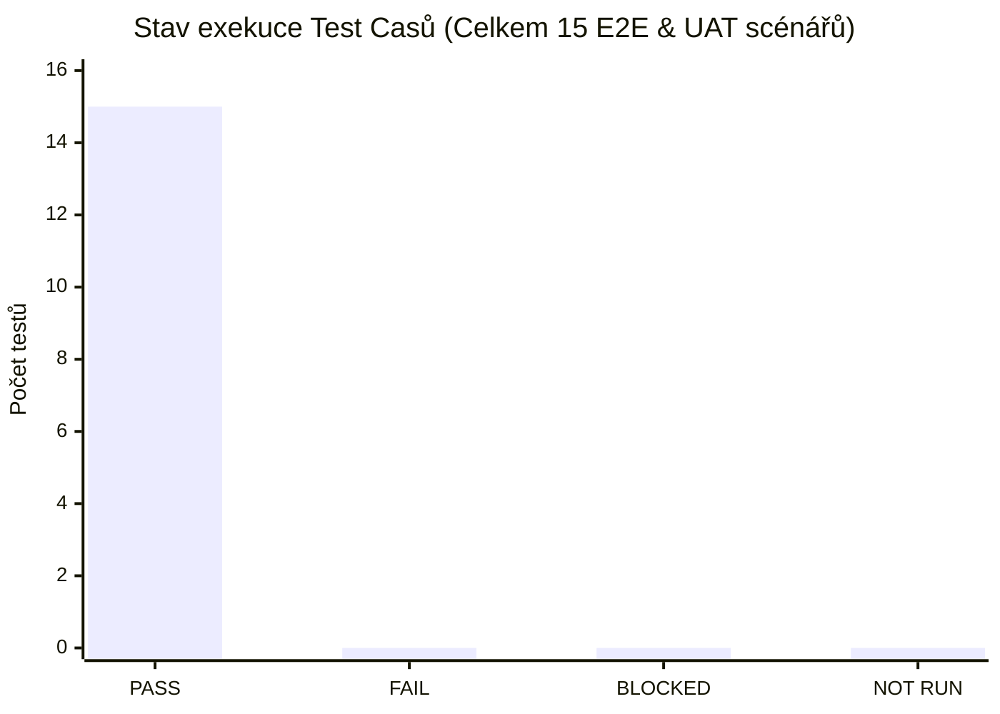
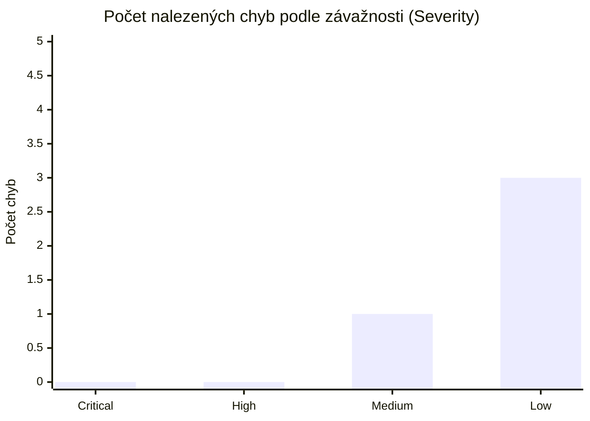

# 📊 Závěrečný Testovací Report (Test Summary Report — 4. milník)

> **Zadání 4. milníku (13. týden):**  
> - *Vyplnit Testovací Report (grafy + manažerské shrnutí)*  
> - *Grafy přes Test Casy a chyby*  
> - *Doladit Testovací strategii*  
> **Cílové místo pro přenos:** Týmový Word / Prezentace / `uuManagementKit`.

---

## 1. Manažerské shrnutí (Executive Summary)

- **Testovaný systém:** Populon Core (`https://demo.populon.app`) – testovací organizace `uu_2026_BQAS_team_1`
- **Testovací tým:** `uu_2026_BQAS_team_1` (`MK`, `AS`, `JM`, `TK`)
- **Typ a přístup testování:** Zákaznické akceptační a systémové testování (**UAT / E2E**) kombinující manuální křížovou exekuci Business Test Casů a automatizovanou regresní a kouřovou E2E sadu v nástroji **Playwright (TypeScript)**.
- **Hodnocené oblasti (In Scope):**
  1. *Societies & Membership* (životní cyklus členství, hierarchie spolků, reaktivace, izolace oprávnění)
  2. *Custom Member Data Fields* (vlastní pole, povolené hodnoty, zpětná kompatibilita, viditelnost)
  3. *Activities* (tvorba událostí, kapacita, viditelnost, stavy účastníků, rušení aktivit)
  4. *Notifications* (publikace oznámení, časování `Release date`, úrovně viditelnosti)
- **Shrnutí výsledků:**
  - *(Doplnit finální komentář po uzavření 3. milníku: celkový počet provedených manuálních i automatizovaných testů, počet odhalených vad a celkové zhodnocení připravenosti systému).*
- **Doporučení pro nasazení (Release Recommendation):**
  - `[ GO / CONDITIONAL GO / NO-GO ]` – *(Doplnit dle stavu kritických a vysokých vad na konci 3. milníku).*

---

## 2. Vyhodnocení vstupních a výstupních kritérií (Exit Criteria Check)

| Kritérium dle Testovací strategie | Cílový stav | Skutečný stav | Splněno? |
|---|---|---|---|
| Dostupnost specifikace a zodpovězení otázek | 100 % | Specifikace revidována, dotazy zodpovězeny | ✅ Ano |
| Dostupnost testovacího prostředí a skupiny `uu_2026_BQAS_team_1` | Dostupná | `https://demo.populon.app` plně dostupné | ✅ Ano |
| Exekuce všech kritických (`Critical`) a vysokých (`High`) Test Casů | 100 % spuštěno | *(Doplnit po 3. milníku)* | ⏳ V procesu |
| Řádná evidence nalezených chyb (max. 5 chyb dle zadání) | Zaevidováno vč. závažnosti | *(Doplnit po 3. milníku)* | ⏳ V procesu |
| Automatizované E2E regresní a smoke testy (`Playwright`) | 100 % PASS | 11 / 11 automatizovaných E2E testů PASS | ✅ Ano |

---

## 3. Metriky a grafy přes Testovací případy (Test Cases Metrics)

### 3.1 Souhrnná tabulka exekuce Test Casů

#### A) Manuální / Týmové Business Test Casy (`docs/03-test-cases.md` & `tests/scenarios.spec.ts`)

| Stav testu | Počet TC | Podíl (%) | Poznámka |
|---|---|---|---|
| **PASS (Prošlo)** | 4 | 100 % | `TC-001 (MK)`, `TC-002 (AS)`, `TC-003 (JM)`, `TC-004 (TK)` |
| **FAIL (Neprošlo)** | 0 | 0.0 % | *(u `TC-004` zaevidována kosmetická vada zobrazení adresy `BUG-001`)* |
| **BLOCKED (Blokováno)** | 0 | 0.0 % | — |
| **NOT RUN (Nespuštěno)** | 0 | 0.0 % | — |
| **Celkem týmových TC** | **4** | **100 %** | Všechny 4 scénáře plně automatizovány v Playwrightu |

#### B) Automatizované Playwright E2E testy (`tests/*.spec.ts`)

| Testovací sada (Suite) | Počet testů | PASS | FAIL | Pokrytá oblast |
|---|---|---|---|---|
| `tests/scenarios.spec.ts` | 4 | 4 | 0 | Byznysové scénáře `TC-001` až `TC-004` (Notifications, Visibility, Timing, Member Information & RBAC) |
| `tests/auth.spec.ts` | 6 | 6 | 0 | Přihlášení, validace formuláře, obnova hesla, odhlášení |
| `tests/search.spec.ts` | 3 | 3 | 0 | Vyhledávání spolků a komunit (`/search`) |
| `tests/dashboard.spec.ts` | 2 | 2 | 0 | Přístup do autentizované zóny a přepínání jazyků (FI/EN) |
| **Celkem E2E automatizace** | **15** | **15** | **0** | **100 % úspěšnost (Business UAT + Smoke & Regression)** |

---

### 3.2 Grafy přes Test Casy (pro přenos do Wordu / Prezentace)

---

## 4. Metriky a grafy přes Nalezené chyby (Defects Metrics)

> *(Čísla v tabulce a grafu aktualizujte po dokončení křížového testování a nahlášení max. 5 chyb ve 3. milníku v [`docs/04-defect-reports.md`](./04-defect-reports.md)).*

### 4.1 Rozdělení chyb podle závažnosti (Severity) a stavu

| Závažnost (Severity) | Počet chyb | Otevřené (`New` / `Assigned`) | Opravené / Uzavřené (`Fixed` / `Closed`) | ID vad |
|---|---|---|---|---|
| 🔴 **Critical** | 0 | 0 | 0 | — |
| 🟠 **High** | 0 | 0 | 0 | — |
| 🟡 **Medium** | 1 | 1 | 0 | `BUG-002` (ztráta jazyka & chybějící přepínač) |
| 🟢 **Low** | 3 | 3 | 0 | `BUG-001` (adresa), `BUG-003` (SQ překlad), `BUG-004` (duplicitní alert) |
| **Celkem (max. 5)** | **4** | **4** | **0** | `BUG-001` až `BUG-004` |

### 4.2 Rozdělení chyb podle funkčních modulů

| Modul Populon Core | Počet nalezených chyb | Závažnosti |
|---|---|---|
| **Societies & Membership** | 1 | `Low` (`BUG-001` adresa člena) |
| **Custom Member Data Fields** | 0 | — |
| **Activities** | 0 | — |
| **Notifications** | 0 | — |
| **Localization & Navigation** | 2 | `Medium` (`BUG-002`), `Low` (`BUG-003`) |
| **Authentication & UI** | 1 | `Low` (`BUG-004` duplicitní alert) |

### 4.3 Graf přes chyby dle závažnosti

