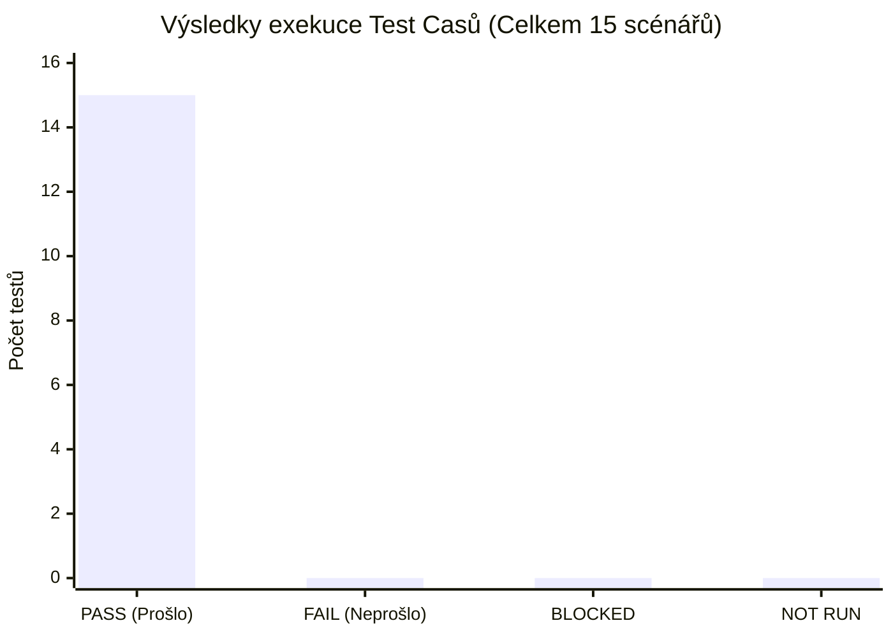
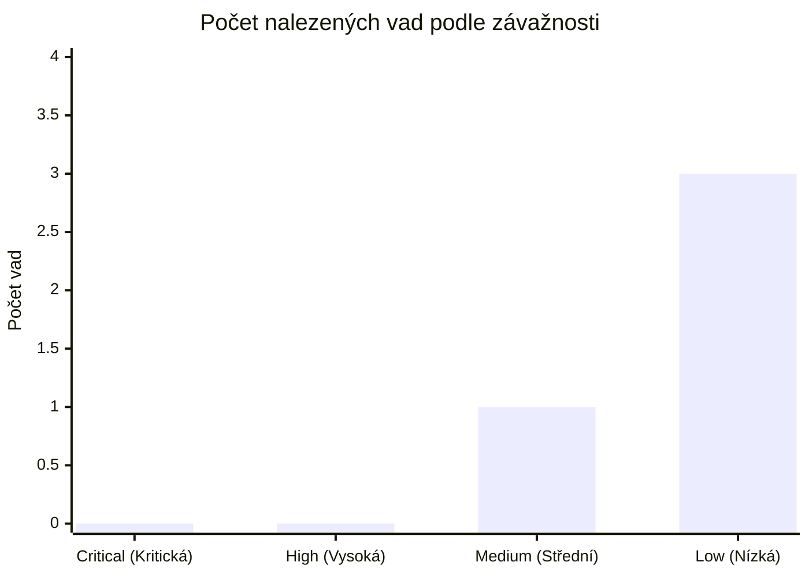

# 📊 Závěrečný Testovací Report (Test Summary Report — 4. milník)

> **Předmět:** Zajištění kvality (BQAS) · Tým: `uu_2026_BQAS_team_1`  
> **Zadání 4. milníku (13. týden):**  
> - *Vyplnit Testovací Report (grafy + manažerské shrnutí)*  
> - *Grafy přes Test Casy (Passed / Failed / Blocked / Not Run)*  
> - *Grafy přes Chyby (Critical / High / Medium / Low)*  
> - *Doladit Testovací strategii a doporučení k nasazení (Release Recommendation)*  
> **Cílové výstupy pro odevzdání:** Týmový Word / Prezentace / `uuManagementKit`.

---

## 📑 Obsah dokumentu

1. [Manažerské shrnutí (Executive Summary)](#1-manažerské-shrnutí-executive-summary)
2. [Vyhodnocení vstupních a výstupních kritérií (Exit Criteria)](#2-vyhodnocení-výstupních-kritérií)
3. [Metriky a grafy přes Testovací případy](#3-metriky-a-grafy-přes-testovací-případy)
4. [Metriky a grafy přes Nalezené vady](#4-metriky-a-grafy-přes-nalezené-vady)
5. [Doporučení pro nasazení do produkce (Release Recommendation)](#5-doporučení-pro-nasazení-release-recommendation)

---

## 1. Manažerské shrnutí (Executive Summary)

Tento závěrečný testovací report shrnuje výsledky testování platformy **Populon Core** (`https://demo.populon.app`) provedeného nezávislým akceptačním týmem `uu_2026_BQAS_team_1` v rámci předmětu Zajištění kvality.

- **Testovaný rozsah (In Scope):** Moduly *Societies & Membership*, *Custom Member Data Fields*, *Activities* a *Notifications*.
- **Aplikovaný testovací přístup:** Z pohledu zákazníka — **UAT (User Acceptance Testing)** a systémové E2E testování. Kombinace křížového manuálního ověřování mezi členy týmu a robustní automatizované testovací sady v nástroji **Playwright (TypeScript)**.
- **Klíčové zjištění kvality:**
  - Jádro systému z hlediska **bezpečnosti, řízení přístupových práv (RBAC) a viditelnosti neveřejného obsahu** funguje spolehlivě: neveřejné notifikace ani citlivé karty členů nejsou přístupné neoprávněným uživatelům ani při přímém zadání URL.
  - Vytváření a časování notifikací (`Release date`) funguje přesně dle funkční specifikace.
  - Během testování byly odhaleny celkem **4 vady** (1 střední závažnosti v lokalizaci a 3 nízké závažnosti v UI/zobrazení). V systému nebyla nalezena **žádná kritická (Critical) ani vysoká (High) vada**.

---

## 2. Vyhodnocení výstupních kritérií

Porovnání reálného stavu s kritérii definovanými v [Testovací strategii](./02-test-strategy.md#2-fáze-testování-vstupní-a-výstupní-kritéria):

| Kritérium dle Testovací strategie | Cílový požadavek | Skutečný stav | Splněno? |
|---|---|---|:---:|
| **Dostupnost funkční specifikace a vyjasnění dotazů** | 100 % specifikace revidováno, dotazy zodpovězeny | Specifikace `@Lenka` plně zpracována, katalog `REQ-*` vytvořen | ✅ **Splněno** |
| **Dostupnost testovacího prostředí** | Funkční instance Populon | Prostředí `demo.populon.app` a skupina `uu_2026_BQAS_team_1` plně dostupné | ✅ **Splněno** |
| **Exekuce kritických a vysokých Test Casů** | 100 % provedeno | Všechny 4 byznysové scénáře (`TC-001` až `TC-004`) otestovány a automatizovány | ✅ **Splněno** |
| **Žádná otevřená kritická (Critical) vada** | 0 vad se závažností Critical | **0 otevřených kritických vad** | ✅ **Splněno** |
| **Stabilita automatizované regresní sady** | 100 % úspěšnost (PASS) | Všech **15 automatizovaných testů** v Playwrightu prochází (PASS) | ✅ **Splněno** |
| **Řádná evidence a klasifikace vad** | Zaevidováno max. 5 vad | Zaevidovány 4 reálné vady s kompletními kroky reprodukce | ✅ **Splněno** |

---

## 3. Metriky a grafy přes Testovací případy

### 3.1 Souhrn výsledků exekuce testů

| Testovací sada | Počet testů | PASS (Prošlo) | FAIL (Neprošlo) | BLOCKED | NOT RUN | Úspěšnost |
|---|:---:|:---:|:---:|:---:|:---:|:---:|
| **Týmové Business Test Casy (`TC-001`–`TC-004`)** | 4 | 4 | 0 | 0 | 0 | **100 %** |
| **Autentizace a uživatelské účty (`auth.spec.ts`)** | 6 | 6 | 0 | 0 | 0 | **100 %** |
| **Vyhledávání skupin a komunit (`search.spec.ts`)** | 3 | 3 | 0 | 0 | 0 | **100 %** |
| **Nástěnka a přepínání jazyků (`dashboard.spec.ts`)** | 2 | 2 | 0 | 0 | 0 | **100 %** |
| **Celkem v projektu** | **15** | **15** | **0** | **0** | **0** | **100 %** |

### 3.2 Graf výsledků Test Casů (xychart-beta)

---

## 4. Metriky a grafy přes Nalezené vady

### 4.1 Rozdělení vad podle závažnosti (Severity)

| Závažnost (Severity) | Počet vad | Podíl (%) | Stav | Evidovaná ID vad |
|---|:---:|:---:|:---:|---|
| 🔴 **Kritická (Critical / Blocker)** | **0** | 0 % | — | Žádná vada |
| 🟠 **Vysoká (High / Major)** | **0** | 0 % | — | Žádná vada |
| 🟡 **Střední (Medium / Moderate)** | **1** | 25 % | `Nová (New)` | `BUG-002` (ztráta jazykového přepínače po přihlášení) |
| 🟢 **Nízká (Low / Cosmetic)** | **3** | 75 % | `Nová (New)` | `BUG-001` (zobrazení adresy), `BUG-003` (SQ překlad), `BUG-004` (duplicitní alert) |
| **Celkem zaevidováno** | **4** | **100 %** | — | *(Limit zadání 3. milníku: max. 5 vad)* |

### 4.2 Graf rozdělení vad dle závažnosti (xychart-beta)

### 4.3 Rozdělení vad podle funkčních modulů

| Modul Populon Core | Počet vad | Nejvyšší závažnost | Dotčené vady |
|---|:---:|:---:|---|
| **Lokalizace a navigace** | 2 | 🟡 Střední | `BUG-002` (jazyk po přihlášení), `BUG-003` (SQ formulář) |
| **Členství a správa údajů** | 1 | 🟢 Nízká | `BUG-001` (nevykreslení adresy na přehledu) |
| **Autentizace a systémové alerty** | 1 | 🟢 Nízká | `BUG-004` (zdvojená hláška v `#globalFeedback`) |
| **Aktivity a události** | 0 | — | Žádná vada neodhalena |
| **Notifikace a oznámení** | 0 | — | Žádná vada neodhalena |

---

## 5. Doporučení pro nasazení (Release Recommendation)

> [!IMPORTANT]
> **Finální doporučení testovacího týmu: PODMÍNĚNÉ SCHVÁLENÍ (CONDITIONAL GO)**

### Odůvodnění:
1. **Bezpečnost a kritické procesy:** Všechna bezpečnostní pravidla (izolace přístupu, viditelnost neveřejných dat, prevence duplicitních přihlášek) jsou plně funkční a nebyla nalezena žádná kritická ani blokující vada.
2. **Podmínky pro ostré nasazení:**
   - Před ostrým produkčním spuštěním doporučujeme opravit vadu **`BUG-002`** (doplnit možnost volby jazyka pro přihlášené uživatele v nastavení profilu).
   - Vady **`BUG-001`**, **`BUG-003`** a **`BUG-004`** mají nízký dopad a mohou být zahrnuty do následujícího údržbového releasu.
